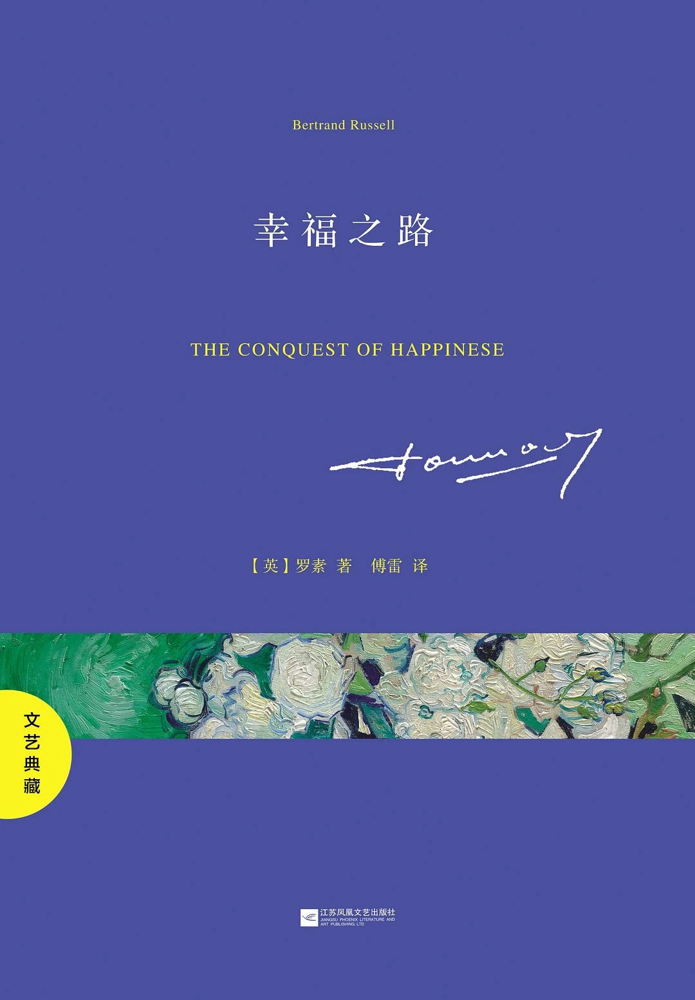

> This is the first book of Zhou Zuoluo's third reading club. It leans a bit toward chicken soup for the soul. Although the Chinese edition was translated by Fu Lei, it was written a long time ago, so the prose still reads a little oddly.

## 1. Overview
*The Conquest of Happiness* is one of the representative works of Bertrand Russell, Nobel laureate in literature and world-famous philosopher, a book of practical life philosophy written for ordinary people. Although it is a work of philosophy, its content is accessible and close to everyday readers, and it has a broad audience. In plain yet profound prose, Russell analyzes why we are unhappy and shows us how to set out on the road to happiness. Without expounding lofty philosophy or delivering dry sermons, Russell simply gathers sensible opinions confirmed by his own experience and observation into a prescription for happiness: lavish banquets and showing off in a fancy car cannot bring happiness; only by abandoning self-centeredness, actively broadening your interests, strengthening your psychological resilience, and engaging with social life can you find real happiness.

## 2. Favorite Quotes
### 2.1 On the roots of unhappiness
- The external causes are the material environment and existing institutions, which lie beyond an individual's power.
- The internal causes are all kinds of psychological knots and traditional beliefs, which lie within an individual's power, yet people often don't recognize them or are unwilling to correct them.
- Adult unhappiness has many underlying psychological causes, and a sense of sin is an important one.
### 2.2 On the self, desire, and mental drain
- A person concerned only with themselves is not admirable or enviable, and others don't find them so.
- Human instinct is never entirely self-centered.
- An overly strong self is a prison; if you want to enjoy life fully, you must escape from it.
### 2.3 On boredom, fatigue, and balance in life
- Boredom is essentially a longing for something to happen, and what is longed for is not necessarily pleasant.
- All great books contain boring parts, and all great lives contain dull stretches of effort.
- Most fatigue comes from worry, and worry can be avoided through a wiser philosophy of life and more mental discipline.
### 2.4 On interest, friendliness, and the road to happiness
- All real success in work depends on genuine interest in the material your work involves.
- The secret of happiness is this: let your interests be as wide as possible, and let your reactions to people and things be as friendly as possible.
- Where external circumstances are not extremely bad, a person should be able to be happy, on the sole condition that their passions and interests are directed outward rather than inward.

## 3. Summary
The key to the road to happiness is not escaping life, but stepping out of the narrow self: broadening your interests, reducing mental drain, staying friendly and caring toward people and things, and finding real joy in a calm, moderate life.

For example, lately I couldn't finish my development tasks at work and the bugs never ended, and for the past few days I was draining myself badly. Yesterday I went out and spent an afternoon talking with people in person, and I realized all that work stuff is minor, and I shouldn't bring work problems home either.

And today when I checked my website data, a site I built three months ago has actually started getting traffic. For building websites for overseas markets, I'm motivated to keep going again.
