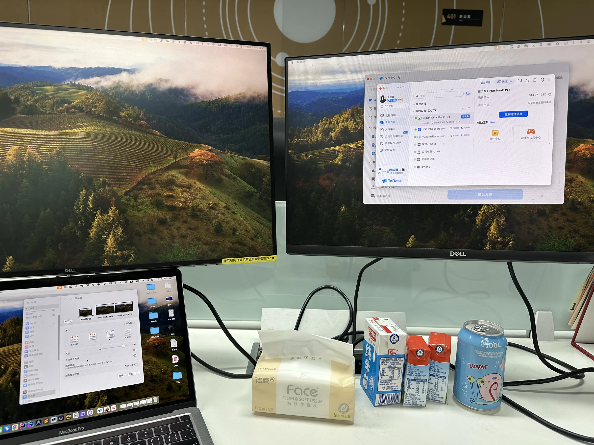
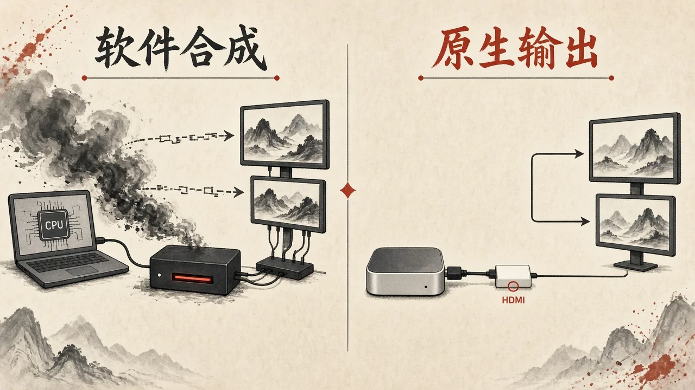

Up front: **I will never use a DisplayLink dual-monitor dock again.**

Not because of the price. Not because of missing ports. Because it is *laggy*.

## At First, It Felt Great

My desk has two Dell monitors. The laptop only has a few USB-C ports. I bought a NEXHYPE "4K Dual Display (DL6950)" dock: one cable in, two HDMIs out. macOS Displays immediately showed two external screens.

I thought I had won: no new computer, no Thunderbolt dock hunt, just dual screens for coding and remote work. The desk finally felt wide open.

## After a While, the Lag Showed Up

The honeymoon ended slowly.

The cursor on the external displays would hitch. Dragging a window across screens felt sticky. Video and long documents dropped frames now and then. Worst of all was ToDesk remote desktop—the external screens were already being software-composited, and stacking a remote session on top made the delay and stutter painfully obvious.

It was not the occasional glitch you can ignore. It was a daily reminder that **the pixels were not coming out natively**.

You have dual monitors, yet a thin layer of lag keeps tugging at your attention.

## Then I Switched to a Mac mini

Later the desk moved to a Mac mini.

It has one HDMI built in for the first monitor. Apple's official USB-C Digital AV Multiport Adapter adds a second HDMI. Both paths are native output. No DisplayLink driver in the middle.

The difference was immediate: **no lag at all.**

The cursor tracks, window drags are clean, remote desktop feels normal. Same dual-monitor layout, completely different feel.

## Why DisplayLink Feels Slow

One short explanation is enough.

Real Thunderbolt / DisplayPort Alt Mode sends display signal straight from the GPU to the monitor. Many "one USB-C, two HDMI" docks use **DisplayLink** instead: the computer compresses the frame with CPU/GPU, ships it over USB, and the dock decodes it onto the screens.

That is an extra software-compositing hop. USB bandwidth, driver scheduling, compression quality—any of them under pressure becomes visible lag. Dual 4K, high refresh, or remote desktop makes it worse.

So the dock is not "broken." This whole approach is software doing a job that should be a display pipe. It works at first and feels clever. Live with it long enough, and you learn what the bill actually is.

## Never Again

Not every dock is the problem. USB hubs, Ethernet, and card readers are fine.

Anything that leans on DisplayLink to fake dual monitors is out for me. Prefer native HDMI / DisplayPort / Thunderbolt when you can. If you must expand, pick a path that does not software-compose the screen.

Dual monitors should make work smoother, not turn every day into a fight with latency.

**DisplayLink dual screens: I will not buy that again.**
