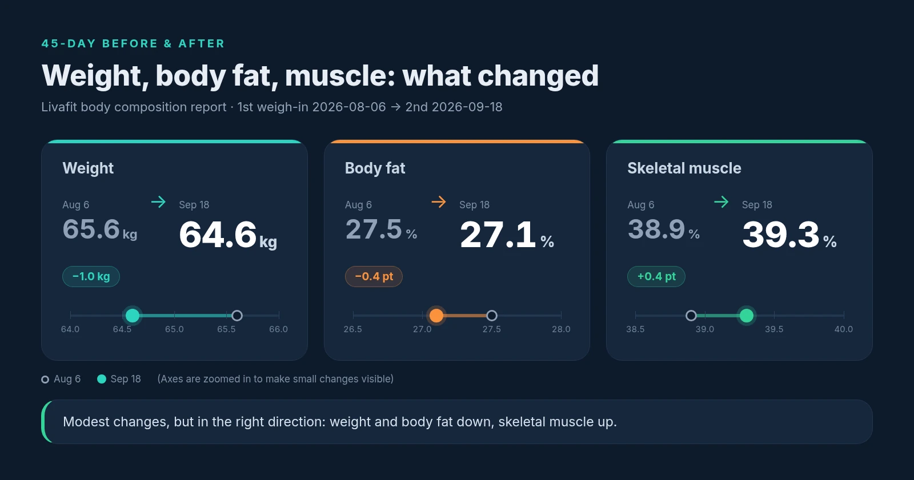
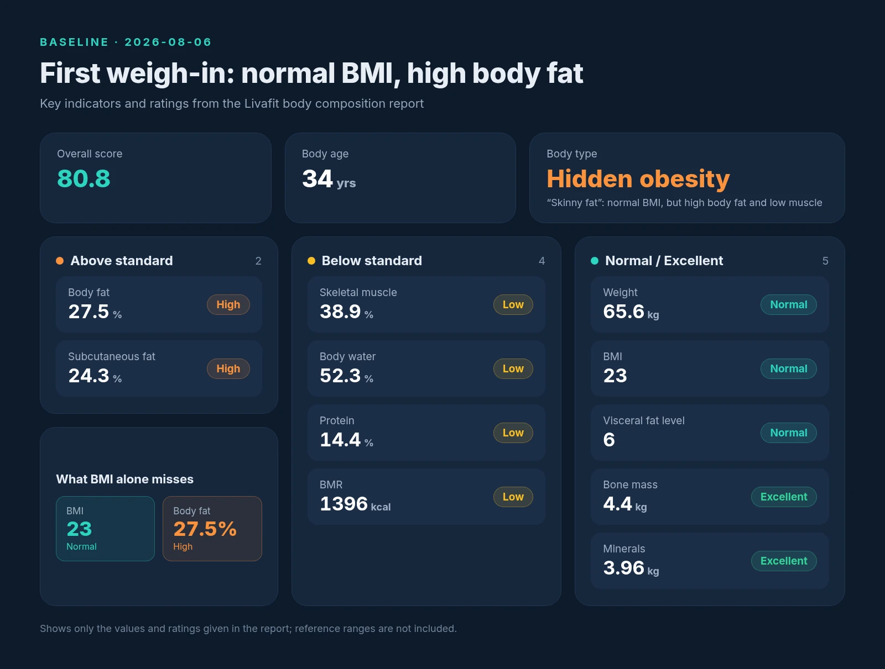
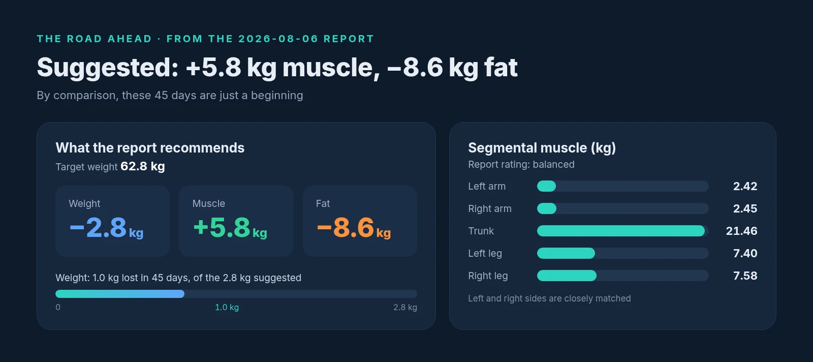
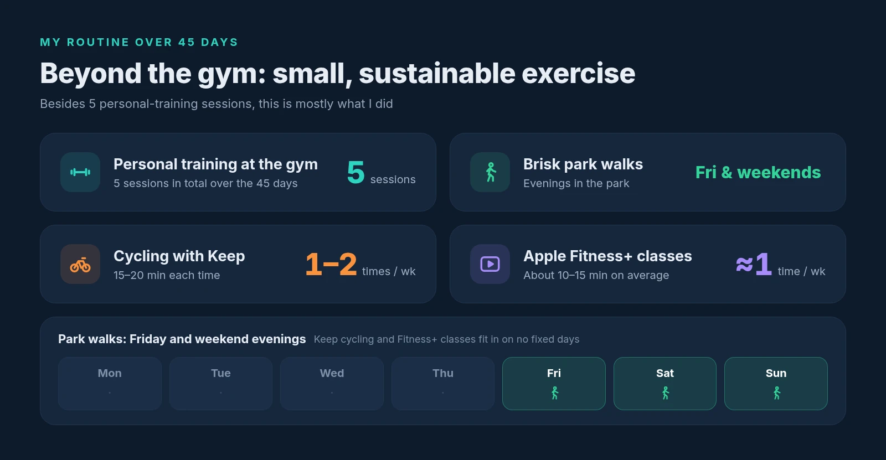

Over the past 45 days, I took 5 personal training sessions at the gym.

Outside the gym, my exercise was nothing complicated: brisk walks in the park on Friday and weekend evenings; cycling with the Keep app once or twice a week, 15 to 20 minutes each time; and an Apple Fitness+ class roughly once a week, about 10 to 15 minutes on average.

My first weigh-in was on August 6 and the second on September 18, both on a Livafit body composition scale with its report. Put side by side, the two reports make up my report card for these 45 days.

## The Results First

- Weight: 65.6 kg → 64.6 kg, down 1.0 kg
- Body fat: 27.5% → 27.1%, down 0.4 percentage points
- Skeletal muscle: 38.9% → 39.3%, up 0.4 percentage points

To be honest, none of these changes is big. I lost just 1 kilogram, and body fat and skeletal muscle each moved by only a few tenths of a point. But the direction is right: fat is going down and muscle is going up. To me, that matters more than how much weight I lost.

## A Normal BMI Doesn't Mean Everything Is Fine

The report really worth a closer look is the first one, from August 6.

That day I weighed 65.6 kg with a BMI of 23, both rated normal. If I had looked only at those two numbers, I would probably have thought I was doing fine.

But in the same report, my body fat (27.5%) and subcutaneous fat (24.3%) were both high, while skeletal muscle (38.9%), body water (52.3%), protein (14.4%), and basal metabolic rate (1,396 kcal) were all low. The body type the report gave me was "hidden obesity," what people often call "skinny fat."

In other words, judging by weight and BMI everything looked normal, but inside there was too much fat and too little muscle. My overall score that day was 80.8, with a body age of 34. BMI only tells part of the story; the body fat and muscle numbers are closer to the real picture.

Of course, the report had some reassuring parts too: my visceral fat level was 6, rated normal; bone mass (4.4 kg) and minerals (3.96 kg) were both rated excellent; and muscle was fairly evenly distributed across my arms, legs, and trunk.

## A Long Road Ahead

The first report also came with recommendations: a target weight of 62.8 kg, which means losing 2.8 kg overall, made up of gaining 5.8 kg of muscle and losing 8.6 kg of fat.

Compared with that, the 1 kg I lost in these 45 days is still a fair way from the suggested 2.8 kg, and gaining 5.8 kg of muscle while losing 8.6 kg of fat is a goal that will take a long time. These numbers made one thing clear to me: this isn't something a month and a half can fix. Keeping the direction steady is more realistic than chasing speed.

## Small Exercise I Can Keep Up

Looking back on these 45 days, what I did was actually quite simple: 5 personal training sessions, plus park walks, Keep cycling, and Fitness+ classes. Apart from the training sessions, none of these takes much time on its own, a dozen or twenty minutes of cycling, ten-odd minutes of Fitness+, but they fit easily into daily life, which makes them easier to stick with.

This report card isn't impressive, but it does show that small, sustainable exercise works. From here, I'll keep going at this pace and let the numbers move, little by little, in the right direction.
