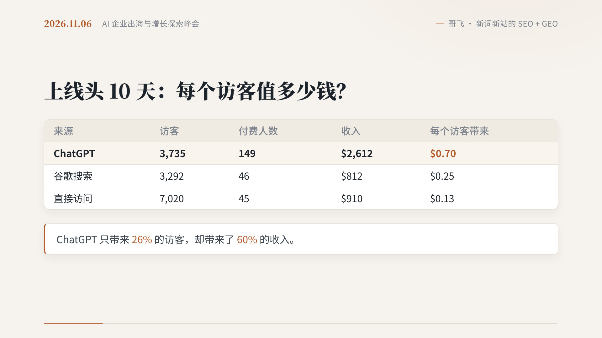
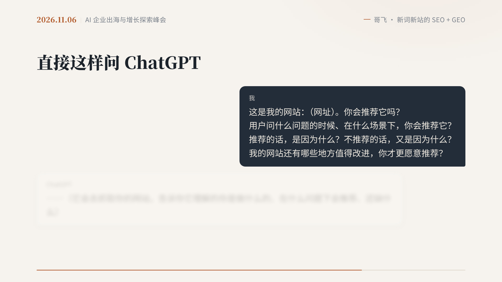
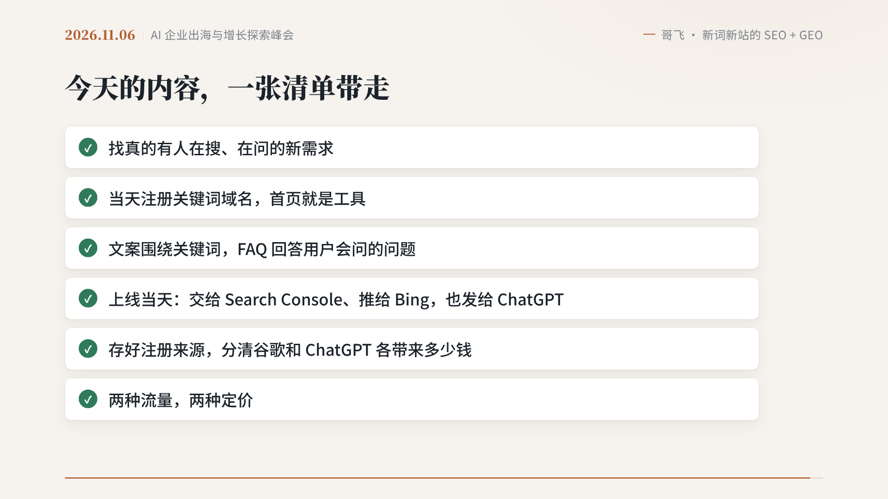

I have spent seven years writing Java and work as a backend engineer in Nanjing. I also build game guide and tool sites for overseas audiences. When I think about traffic, I have mostly been thinking about Google: finding keywords, getting indexed, and climbing the rankings.

Lately, though, I keep hearing about another entry point: users do not search, they just ask ChatGPT. In a recent post about an offline talk, I also noted that AI search is often the first channel to show results, and that clicks from inside the app are frequently counted as direct traffic.

On November 6, 2026, Gefei gave a talk at the Shanghai conference "AI Companies Going Global and Exploring Growth." The title was *New Keywords, New Sites: How to Earn SEO and GEO Traffic at the Same Time*. GEO here has a very concrete meaning: getting AIs such as ChatGPT to recommend your site in their answers, and to send you visits.

I have gone through this talk and written the notes down, not to repeat a 175-slide deck, but to keep the parts that are most useful to me: why ChatGPT is willing to send traffic to new sites, how to do it, and what I plan to try next.

On November 11, Gefei also posted on X that OpenAI had officially launched Business in ChatGPT. The two things fit together. Until now, we have mostly had to guess from our own analytics whether ChatGPT recommended us. In the future, verified businesses may be able to see how often their products are mentioned, much as we do in Google Search Console.

## First, a Case: Traffic That Arrives Fast Also Leaves Fast

Gefei began with an AI video site he launched on September 28. On the first day it received 600 unique visitors, 17 orders, and $221 in revenue. Every paying user came from a ChatGPT recommendation. The site had no backlinks and no paid ads.

By the time of the talk, the site had about 17,000 unique visitors, including 4,600 from ChatGPT and 3,700 from Google, and a little more than $6,100 in total revenue, with ChatGPT contributing the most.

Broken down by source over the first ten days, the numbers are even clearer:

ChatGPT sent 3,735 visitors, of whom 149 paid, or about $0.70 per visitor. Google sent 3,292 visitors, at $0.25 each. ChatGPT made up only 26% of visitors, but 60% of revenue.

There is another side to the story. The site caught an AI video trend on TikTok. When the trend took off on September 29, ChatGPT sent more than 1,000 visitors in a single day. After the peak, the traffic dropped by about a third each day. Two weeks later, ChatGPT sent only 123 visitors in a week, while Google still sent 352 visitors and 10 paying users, and had become the main source of payments.

Gefei put it cleanly: **ChatGPT is the increment that arrives fast and leaves just as fast. Google is the base you can hold on to.**

For someone like me, who is more used to Google SEO, that is both a warning and a relief. It does not mean giving up Google. It means adding another leg.

He later launched two more new sites, and both also received ChatGPT traffic. One of them also shows how quickly this can happen: after ChatGPT's crawler indexed the pages in one pass, the first visitor arrived two hours later. On another site, visits from Bing, DuckDuckGo, and Yahoo — all of which use Bing's index — added up to more than Google. That is why the talk keeps coming back to this: on launch day, do not submit only to Google.

## Why New Sites Still Get a Chance

Gefei's method for a new keyword and a new site is short: find a keyword that is just emerging, register a domain with that word the same day, launch a site whose homepage already meets the need the same day, then earn traffic from Google and ChatGPT and start taking orders.

The reason is not complicated. The top results for old keywords have long been taken by large sites. A new site has to compete on authority, backlinks, and time. For a new keyword, competition is almost empty, and a brand-new need can only be met by a brand-new page.

Over National Day, the community ran a group experiment. From September 28 to October 8, 49 members launched sites around new keywords, and all of them got orders. Forty-one mentioned ChatGPT traffic in their retrospectives, and more than twenty said their first order, or most of their orders, came from ChatGPT recommendations. Of course, some members still received most of their traffic from Google. There is room on both sides.

What is more worth keeping is the logic behind it.

Google is willing to send traffic to new sites because it has to satisfy all kinds of new, even unusual, searches. For a brand-new site, it will first give some impressions, then watch whether people click, whether they use the site, and whether they go back to the results to look for something else. For new demand, it can only rely on new pages. For old demand, it is also looking for new pages that do the job better.

Replace "Google" in that loop with "ChatGPT," and it still holds. Users now also take their needs to ChatGPT. For old demand, it crawls old sites and new ones. For brand-new demand, what it can find is often only the new pages that have just been made.

Over the past year, Gefei has observed a few concrete traits of ChatGPT:

- The crawlers really do come. OAI-SearchBot is responsible for indexing. When a user asks a question, ChatGPT-User will also open your page on the spot, and you can see this in your server logs.
- Once a page is indexed, traffic may follow. Some sites started being recommended a few hours later.
- It does not look at site authority, or at the DR people often talk about. It looks at whether this particular page can answer the user's question this time.
- So for a new site built around a new keyword, ChatGPT traffic does not depend on backlinks, and the cost is low.

He also made another important point: luck is still involved. The same actions get some sites recommended and leave others out. Recommendations also fluctuate, so one day's volume should not be treated as stable income. Speed matters too. If you launch a few days late, the slot for that new keyword on ChatGPT's side may already have been taken.

## How to Earn Traffic from Both Sides

The process the community has tested is a single set of actions submitted to both sides, in six steps.

**Step 1: Find a real need.** On the Google side, look in Google Trends for keywords that are just emerging. On the ChatGPT side, use a tool like SimilarWeb to see which sites ChatGPT is sending traffic to. Do not only look at large sites. Look at the small ones further down the list, and at the needs they satisfy. After you find a keyword, ask ChatGPT yourself and see which pages it recommends now, and what those pages are doing right. There is only one prerequisite: people are actually asking. A need that no one is asking about will bring no traffic, no matter how well you build it.

**Step 2: Build the site.** Register a domain that uses the keyword, give each keyword its own site, and let the homepage do only that one thing, ready to use as soon as it is opened. ChatGPT prefers to recommend pages that match the need exactly. It also helps to give each feature its own inner page. One member found that with only a homepage, ChatGPT could not recognize a certain feature; after an inner page was added, it could explain the feature clearly and even linked straight to that page in its recommendation.

**Step 3: Write the page.** These points help on both Google and ChatGPT: write the copy around the keyword, and keep the whole page focused on one thing; use an FAQ to answer the questions users will ask, such as how it works, how much it costs, and whether it is free; render the page on the server so a crawler sees the body text as soon as it opens the page; and check `robots.txt` and Cloudflare settings so AI crawlers are not blocked. As for `llms.txt`, Gefei's judgment is that adding it or not makes little difference. It is not the key.

What kinds of pages are more likely to be recommended? Gefei compared data from his own site. Broad questions, or evergreen head terms, get no visits: ChatGPT either answers them itself or points to a major tool. The pages that did receive visits were usually named after that new meme or that specific task. Write the title the way users ask the question, and answer in the first two sentences: what it is, how to do it here, and how much it costs.

I also kept this pair of numbers: of 1,041 ChatGPT visitors who landed on a tool page, 54 paid; of 130 who landed on a tutorial page, only 1 paid. Tutorials are for being cited; tool pages are for conversion. The first screen of a tutorial should link to the tool page.

**Step 4: On launch day, submit to three places at once.** Submit the site and sitemap to Google Search Console. On the Bing side, push new pages through IndexNow, then submit the sitemap in Bing Webmaster Tools. The ChatGPT step is so simple it is almost hard to believe: send it your URL, and just ask.

Gefei's wording is:

> This is my website: (URL). Would you recommend it? When users ask what kinds of questions, and in what situations, would you recommend it? If you would, why? If you would not, why not? What else should I improve so that you would be more willing to recommend it?

It will fetch the site, then tell you what it understands you do, in what questions it would recommend you, and what is still missing. Make the changes, then ask again.

Why do this together with Bing? Data from Gefei's own site: several new pages received no ChatGPT visits at all, until he found that IndexNow had not been set up correctly. After he fixed it and pushed the pages to Bing, visits arrived the same day. After that, each new page usually saw its first ChatGPT visitor about a day after being pushed to Bing. On another site, where Bing never indexed the pages, he could only wait for ChatGPT's own crawler, which took three days.

He also has a three-step method: first ask ChatGPT, if you were a user looking for this kind of tool, how would you ask, and get a list of questions; then open a new window and ask the questions one by one, to see which pages it fetches; finally hand the results to an AI and ask what the pages still need. One member reported that after introducing the site to ChatGPT, a new conversation without the URL already included links to the site and its feature pages.

**Step 5: Read the data, and do not let ChatGPT traffic go invisible.** Links opened inside the ChatGPT app often arrive without a referrer, and analytics will count them as direct visits. Look at visits with `utm_source=chatgpt.com`, a source tag that recommended links often carry. It is best to store the source when a user signs up, then match it order by order, so you know which channel is actually making money.

**Step 6: Monetize.** Members have observed that the two kinds of traffic are better served by two kinds of pricing. Users from ChatGPT often convert at a higher rate, but mostly in small, one-time payments. Users from Google convert at a somewhat lower rate, but are more willing to accept a higher price. Users from Bing are even more willing than Google users to pay a higher price. These are observations from individual sites, not industry statistics. Gefei's reading is that the people behind the three entry points are also different: ChatGPT leans younger, Google covers all ages, and Bing leans older, with a higher average order value, but those users dislike surprise charges, so the price needs to be stated clearly up front.

## A Checklist, and One New Change

At the end of the talk, he gathered the day into a checklist:

- Find a new need that people are actually searching for and asking about
- Register a keyword domain the same day, and make the homepage the tool itself
- Write the copy around the keyword, and use an FAQ to answer the questions users will ask
- On launch day: submit to Search Console, push to Bing, and also send the URL to ChatGPT
- Store the signup source, and separate how much money Google and ChatGPT each brought in
- Use two kinds of traffic, and two kinds of pricing

His judgment is that in 2023, the opportunity for community members was to earn traffic from Google for new AI-related demand; from 2026 to 2027, the largest new opportunity is to earn traffic from ChatGPT. The Google base still has to be protected.

On November 11, in [this post](https://x.com/gefei55/status/2120307701872029825), Gefei wrote that people had been discussing a ChatGPT version of Google Search Console for the past few days. That day, OpenAI officially launched Business in ChatGPT. At its core, Business Hub lets verified businesses see when their products are mentioned by GPT. It also supports creating Business Agents so users can talk directly with a business, though for now this is limited to e-commerce and online service businesses in the United States.

In a follow-up, he added two official screenshots and wrote, "Look at the second image — it actually has quite a few features." The first shows Brand insights: mention counts, profile views, website clicks, and the topics through which users discover you. The second shows a business card appearing directly in a conversation, where a user can view the website or start a chat.

The details should follow [OpenAI's official blog post](https://openai.com/index/introducing-businesses-chatgpt/). What feels most relevant to me right now is the first half: we may soon be able to see more clearly whether we have been mentioned by ChatGPT, and on what questions. As for Business Agents, they are still only open to some businesses in the United States. I am noting that for later, not waiting on it.

## The Steps I Plan to Try First

After going through all of this, I do not feel I can reproduce those numbers right away. They came from Gefei and other community members running inside a new-keyword window, and ChatGPT's recommendations fluctuate on their own.

I would rather start by finishing the things I can already do on my own sites.

First, check the `robots.txt` and Cloudflare settings on my current sites, and make sure OAI-SearchBot and ChatGPT-User are not being blocked.

Second, the next time I launch or update a page, do not submit only to Google Search Console. Set up IndexNow and Bing Webmaster Tools as well, then send the URL to ChatGPT and ask the questions above.

Third, add the source to analytics and to user records. At the very least, I should be able to see `utm_source=chatgpt.com` separately, and remind myself that some ChatGPT visits opened inside the app may be hiding in direct traffic.

I will start with these steps, then look at the results. Google is still the base, but I do not want the ChatGPT increment to remain something I have only heard is important.
