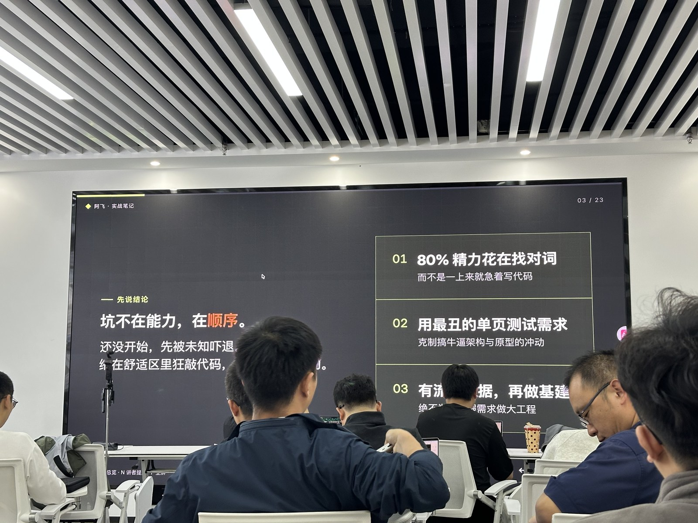
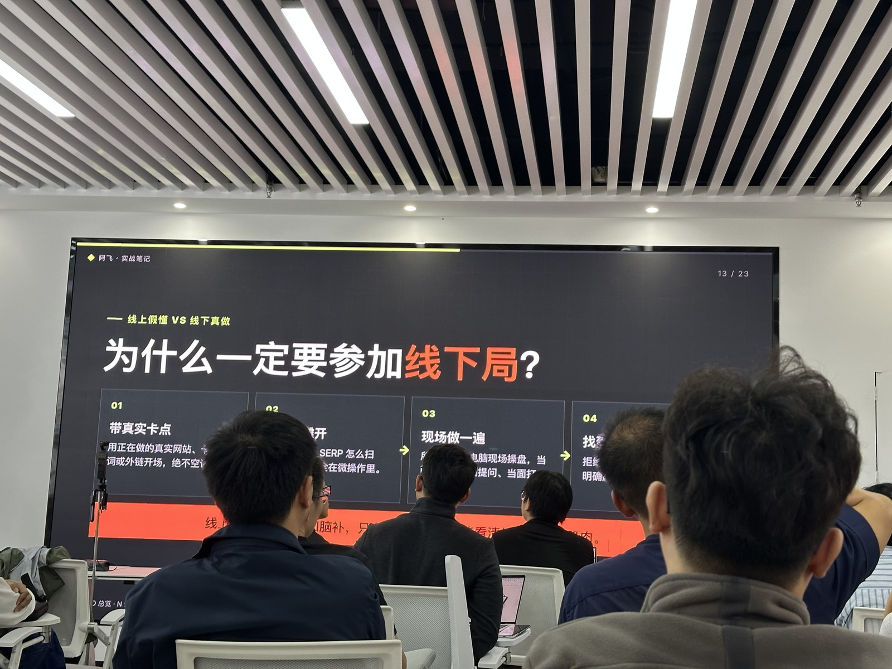
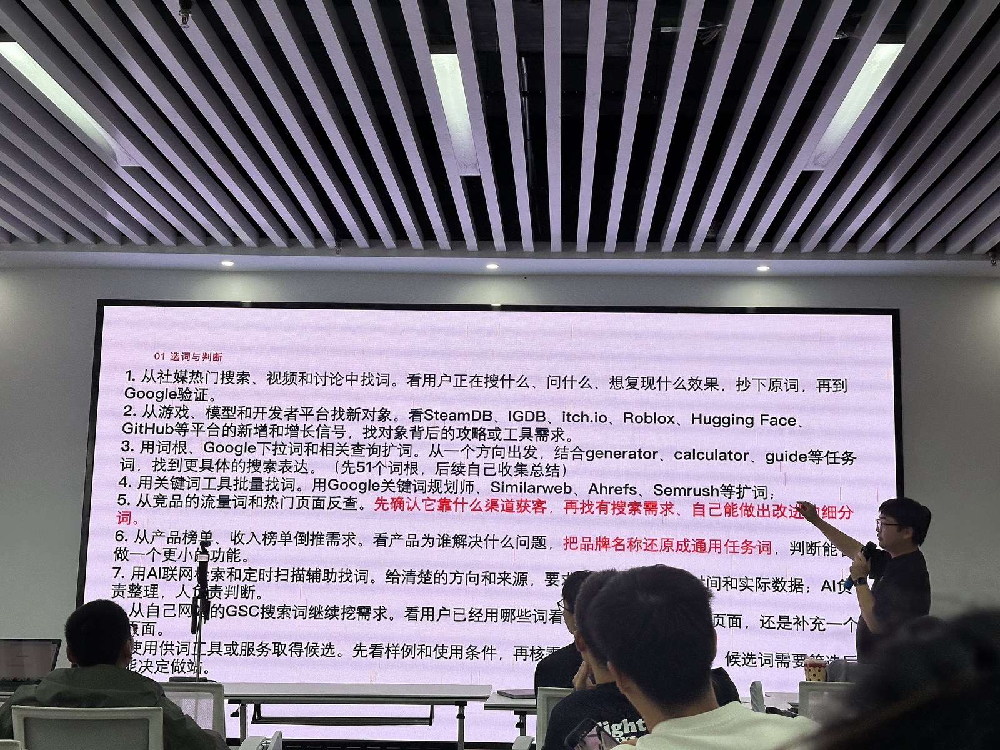
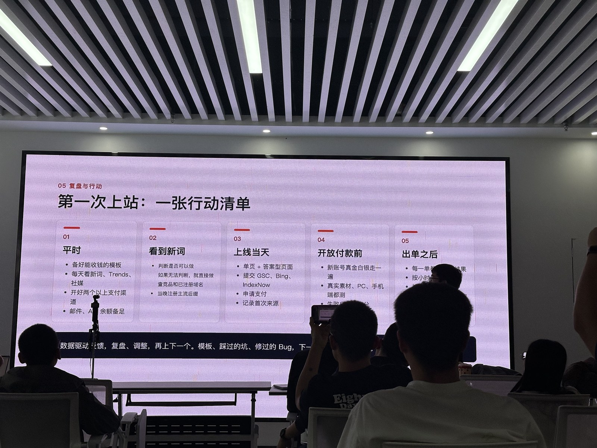

I have spent seven years writing Java and work as a backend engineer in Nanjing. I am also building game and tool sites for overseas audiences. It is not as though I have had no feedback: my best-performing site, crimsondeserthq.com, has roughly 1,530 GSC clicks over the past 28 days.

But getting traffic and making a business work are different things. I have not yet completed the full journey from an emerging keyword to launch, traffic, and payment.

After listening to *Afei’s Practical Notes* and *A Beginner’s Website Launch Action Manual*, one sentence stayed with me: **The problem is not ability. It is the order in which we do things.**

One talk explored why results remain elusive; the other explained how to get a first site moving. Together, they made me reconsider the step I actually need to solve now.

## Knowing How to Code Does Not Mean Coding Comes First

As an engineer, I easily start thinking about stacks, deployment, templates, and automation. They are familiar, and they make it easy to feel that I accomplished plenty today.

But users do not pay because I designed an elegant architecture.

The talks suggested spending 80% of the effort on finding keywords, testing demand with even an ugly single page, and building infrastructure once there is traffic data. I do not take that to mean we should never prepare templates. Preparation just should not become the main project. A reusable foundation only needs to be sufficient. Real demand should decide whether this site deserves to exist.

Looking at the five pitfalls, I would rather turn them into questions for myself than use them to judge other people.

### 1. Have I Reversed the Order?

Planning how a system will scale before confirming who needs it is a natural engineering habit. I need to ask myself: does the user want this feature, or do I simply enjoy building it?

### 2. Am I Making a Decision, or Putting One Off?

A direction might be too competitive, a domain too forgettable, a framework the wrong choice. Each concern sounds reasonable alone. Together, they may prevent a first version from ever appearing.

A better question for me is whether I can make a small, reversible attempt instead of figuring everything out at once.

### 3. Am I Treating New and Established Keywords as Mutually Exclusive?

The talks framed emerging keywords as practice for completing the loop, and established keywords as a longer-term investment. The former may bring quick feedback or disappear quickly; the latter have more established demand, but also more competition and a longer accumulation period.

This does not contradict my earlier intention to move toward subscription SaaS. Practicing payment and delivery around one small need does not mean chasing trends forever. Practicing the loop and choosing a long-term direction can be separate things.

Nor do I want to treat “feedback in a few days” as a guarantee. Timing depends on demand, competition, and execution.

### 4. Am I Substituting Familiar Experience for SEO Fundamentals?

Short-video recommendations are not the same as matching search intent. Development experience cannot replace understanding indexing, search results, and backlinks either.

Even with some clicks already coming in, I need a beginner’s mindset. What is the user trying to accomplish? Which pages does Google show? Why would someone click mine? Those questions cannot be skipped.

### 5. Am I Improving Efficiency, or Using Infrastructure to Soothe Anxiety?

Automated keyword discovery, trend monitoring, and candidate scoring all sound ideal for programmers. But if I cannot judge a keyword manually, automation merely repeats an unclear judgment at scale.

The contrast mentioned in the talk—more than a dozen infrastructure systems, yet not one site taking off—was striking. That is not my own track record, but it is a warning worth keeping nearby: **Complete the process by hand before trying to repeat it at scale.**

## Why I Still Want to Meet People Offline

When I previously wrote about an offline meetup, I felt that hearing what people had actually done was more useful than thinking about direction alone.

This time was similar. Online tutorials can feel completely clear, yet leave me unsure what to do after closing the laptop. Opening the search results, choosing a keyword, and deploying a page reveals where I am really stuck.

For me, the value of meeting offline is not coming away with a secret formula. It is turning “I understand” into a concrete question: have you actually done this step? If not, try it now.

What I need next is not more bookmarked material, but real problems from hands-on work that I can bring into a conversation.

## Six Gates to Keep Beside Me While Working

There are many channels and details. I do not want this post to become a course handout, but this table is worth keeping for my next launch.

The rule is simple: **Solve the gate you have not passed. Do not use busyness at the next one to hide the problem at this one.**

| Gate | Question | Passing criterion |
| --- | --- | --- |
| Find keywords | What need is emerging now? | Find one to three candidates starting to grow in the past seven days; keep sources and dates. |
| Evaluate | Is this worth building now? | Check demand and competition, reasons to visit, and delivery ability; do not skip hard constraints. |
| Launch | Can I catch the window? | Aim for a first version that accepts payment and delivers within 24 hours; do not delay for perfection. |
| Get traffic | Can users and search engines find it? | Submit for indexing, publish answer-oriented pages, and verify analytics; submission is not indexing. |
| Convert | Will someone pay? | Track the funnel from visit to payment and get a real first order, not just a configured payment integration. |
| Deliver and review | Can I keep the promise and make the numbers clear? | Deliver reliably; subtract API, hosting, fees, and refunds before deciding to continue, adjust, or switch keywords. |

A compact reminder of the nine discovery channels, so I do not keep staring at one tool:

1. Social searches, videos, and discussions: copy users’ actual words, then verify them on Google.
2. New releases and growth signals on SteamDB, IGDB, itch.io, Roblox, Hugging Face, and GitHub.
3. Task roots such as generator, calculator, and guide, expanded with Google autocomplete.
4. Google Keyword Planner, Similarweb, Ahrefs, and Semrush for keyword expansion.
5. Competitors’ acquisition channels and popular pages, looking for small needs I can serve better.
6. Product and revenue rankings, working backward to the user’s task rather than just brand names.
7. Scheduled AI scans of clearly specified sources, retaining dates and data, with human judgment.
8. Real queries in my own GSC, deciding whether to add a page or improve an existing one.
9. Keyword services: check samples, data, and usage conditions instead of accepting everything blindly.

For evaluation, I especially want to remember three checks: who occupies the first ten search results; whether users still have a reason to click after an AI summary; and whether the material, functionality, and cost allow me to deliver my promise.

Uploading, calculating, or interacting may provide a reason to visit, but that remains a hypothesis to test—not proof of a business simply because a keyword describes a tool.

A launch foundation is useful: login, payment, credit refunds on failure, downloadable delivery, source tracking, and terms and privacy pages. Email, payments, and generation APIs need usable backups and balance alerts. But prepare enough to support this experiment, rather than stuffing every capability into the foundation.

Before launch, remove old brands, domains, placeholders, and fabricated testimonials; check for exposed secrets; and test the production URL on phone and desktop. Basic checks also include the primary-domain redirect, canonical, robots, noindex, GSC, sitemap, and GA4 real-time events.

Do not simply wait for Google, either. Publish answer-oriented pages and observe AI search, add relevant links from existing sites, and share real examples with people who need them. AI recommendations do not guarantee immediate results, and direct traffic cannot all be attributed to AI. If testing search ads, work out acquisition cost per order against gross profit first.

Visits without registrations suggest checking the first screen and intent. Registrations without uploads suggest checking the flow and mobile experience. Reaching the paywall without paying suggests checking prices and steps. For a generation tool, track **visit → registration → upload → paywall → payment**, together with first source, UTM, and landing page. Other types of site should adapt the funnel to their actual flow.

## Five Days Is Not a Promise of an Order in Five Days

I want to use this training table to keep myself accountable. The goal is not that I must make money by Friday. It is to have real observations by Friday, rather than a pile of assumptions.

| Day | Practice | Keep as evidence |
| --- | --- | --- |
| One | Keyword to site: inspect sites launched one week to one month ago | Candidate keywords, sites, and evidence of growth. |
| Two | Site to keyword: trace their roots and narrower needs | One focused task worth testing. |
| Three | Data analysis: unpack traffic paths and backlinks | Where users might come from and the evidence for that judgment. |
| Four | Minimal page: complete only the core task | An accessible page whose delivery can be tested. |
| Five | Review actual data and bottlenecks | Decide what to fix, whether to observe longer, or whether to stop investing. |

Five days is a training cycle, not an SEO results timeline. Without data, check indexing and distribution, and consider sample size and observation time. Short-term silence does not automatically mean there is no demand.

## Five Checks for My First Launch

- **Prepare normally:** Keep one sufficient template that can take payments; watch emerging keywords and social discussion; prepare backup payment channels and email/API balances.
- **When a keyword appears:** Check demand, search results, competitors, and domains. If uncertain, run a low-cost experiment, but do not skip compliance, cost, or delivery checks.
- **On launch day:** Publish the core page and answer-oriented pages; submit to GSC and Bing; where appropriate, notify supported search engines with IndexNow; record first sources.
- **Before opening payments:** Complete a real payment test with a new account on desktop and mobile. Verify real inputs, delivery, and credit refunds on failure, rather than trusting a successful API response.
- **After an order:** Verify every delivery, then inspect funnel bottlenecks. Traffic without orders calls for conversion checks; no traffic calls for distribution checks; fading interest calls for restraint. Even after it works, do not rush to pile on features.

Writing this down, I think the most valuable thing to take away from both talks is still the order.

I do not need to prove I can build a complex system first. My next step is to choose one emerging keyword and seriously follow this five-day table. Connect discovery, launch, traffic, payment, and delivery before thinking about scale.

Once that is done, I will write another review with actual data and actual obstacles. Even a disappointing result will be more useful than saving ten more tutorials.

**Run through it once before talking about mastery.**

> These are my notes and reflections after *Afei’s Practical Notes* and *A Beginner’s Website Launch Action Manual*. The five pitfalls, six-gate process, and training checklist draw on those talks; thank you to the speakers. The action plan is an exercise for myself, not a promise of earnings or results within a particular time. Images are photographs from the event.
