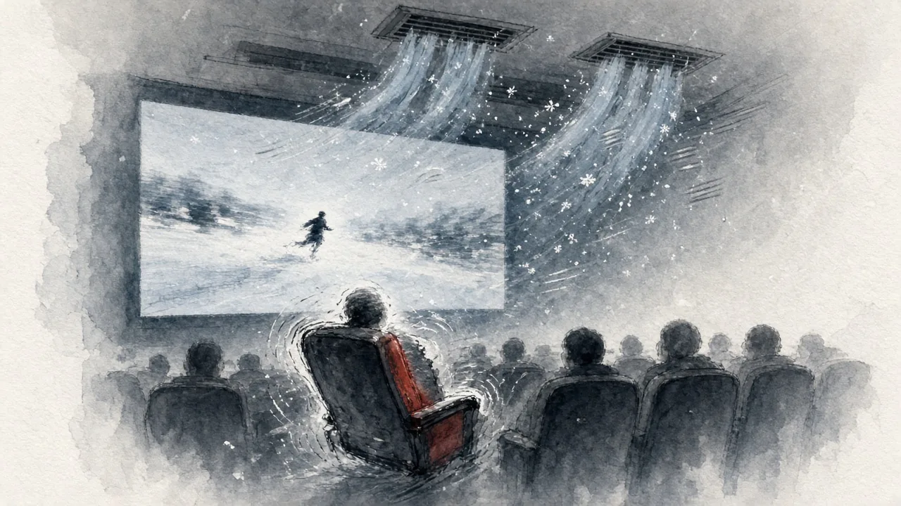
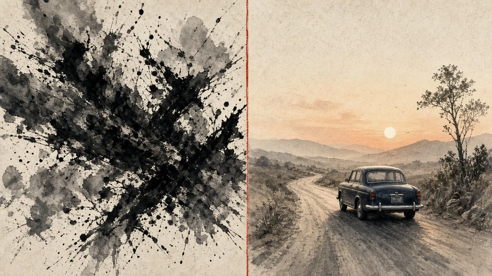

It's Halloween Eve, so I figured I'd get into the spirit and catch the new Resident Evil movie tonight (the Chinese title is 《生化危机：爆发夜》).

Short version: **I was really disappointed.**

## A thin plot built to scare you

Looking back, the story was pretty average. The whole film seemed to have one goal: make you jump. Sudden appearances, sudden noises, one after another, a bit like *Stranger Things*.

It worked, sure. But once the scare passed, nothing stayed with me.

## The gore made me feel sick

What bothered me more was the blood and violence. It wasn't thrilling. It was just gross, and there were scenes I honestly didn't want to keep watching.

Some people love that stuff. I now know I'm not one of them.

## Like watching someone else play a game

The whole movie felt like a first-person game. The camera runs, hides and fights with the characters, and I'm sitting there watching someone else play.

It reminded me of playing *Left 4 Dead 2* with friends. Except back then I had a controller in my hands and friends next to me, and the tension was the fun part. In a cinema, all I could do was sit and watch.

## The one thing worth it: 4D

If anything made the ticket worthwhile, it was the 4D experience.

The seat rocked and shook along with the action. When the lead was running through ice and snow, cold air actually blew down from above the seat. That moment pulled me out of the movie and into it at the same time.

If you want to try 4D, go for it. For the film itself, I'd skip it.

## I like story-driven films better

After the *Stranger Things* series and tonight's movie, it finally clicked: **I prefer story-driven films.**

Something like *Green Book*. You walk out still thinking about it, and the two hours feel like they meant something.

Scare-fest movies get your heart racing while they last, and then there's nothing left when the lights come up.

Next time I'll be more honest when picking a movie: skip the seasonal hype and choose what I actually enjoy.
