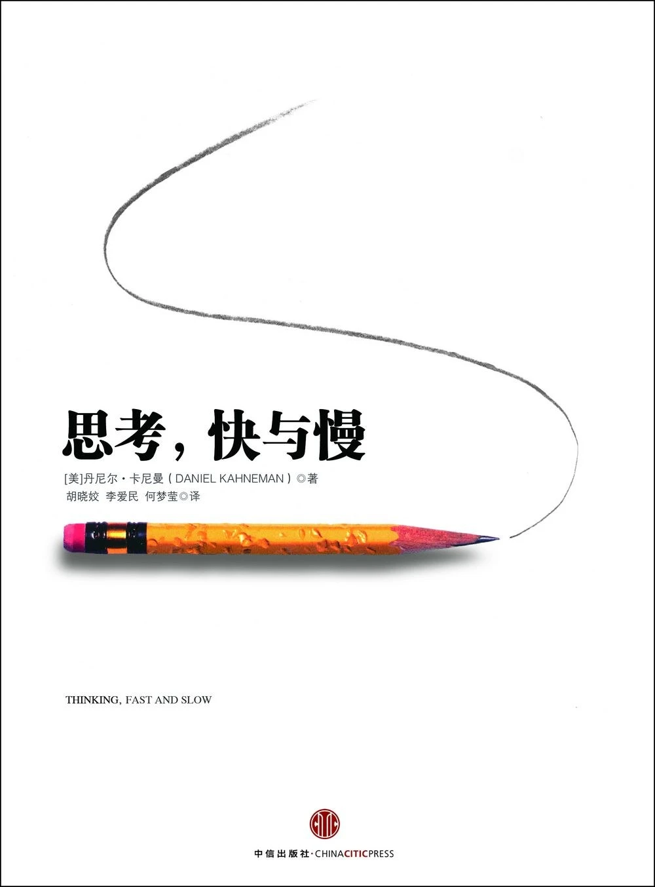

> This is the tenth book of Zhou Zuoluo's second reading club. It leans toward theory and lecturing, and I didn't finish it either.

## 1. Overview
*Thinking, Fast and Slow* is the classic work of Nobel laureate in economics Daniel Kahneman, a clear and inspiring summary of his lifetime of research. As a pioneer of behavioral and experimental economics, Kahneman has had a far-reaching influence.

Kahneman argues that two systems drive the way we think and decide: System 1 makes fast judgments based on intuition, emotion, and memory; System 2 is slower, more deliberate, and more logical. By explaining how these two systems operate in the brain, Kahneman reveals the pervasive influence of fast thinking and intuitive impressions on human thought and choice. Through vivid dialogues and experiments, he shows when we can trust our intuition and when we can't, and how we can use the strengths of slow thinking to make better choices than the rational agent of traditional economics.

## 2. Favorite Quotes
### 2.1 System 1 / System 2 and how thinking works
- When things get difficult, System 2 takes over and has the final say.
- System 1 runs automatically and cannot be switched off at will; errors of intuitive thinking are usually hard to prevent.
- Impressions generated by System 1 often turn into beliefs; it is also the source of impulses, which in turn become your choices and actions.
- System 1 constructs representations of reality that are excessively coherent.
- Frowning usually heightens System 2's vigilance and reduces overconfidence and reliance on intuition.
### 2.2 Cognitive biases and errors of judgment
- Focusing on errors doesn't belittle human intelligence, just as a medical textbook's focus on disease doesn't deny health.
- It's easier to spot other people's mistakes than your own.
- High intelligence does not make people immune to biases.
- The halo effect magnifies the importance of first impressions, sometimes even making people blind to later information.
- When people like a technology, they think its benefits are large and its risks small; when they dislike it, they can only think of its drawbacks and rarely its advantages.
- Some stereotypes are harmful errors, and hostile stereotypes can have serious consequences, but psychological facts can't be avoided.
### 2.3 How attention, energy, and physical state affect thinking
- Anything that occupies working memory reduces your ability to think.
- Switching tasks frequently and speeding up your mind is not pleasant, and people avoid it whenever possible.
- Walking wakes up the body and sharpens the mind.
- Early risers lose self-control in the evening; for night owls it's the reverse.
- I made myself smile, and it really did make me feel much better.
- There is evidence that when tired or depleted, people are more likely to be swayed by empty but persuasive messages, such as advertising.
- Under pressure, everyone's true nature is laid bare.
### 2.4 How to express yourself and tackle problems
- If you want to seem smart and credible, keep it simple and concise; don't use complicated language.
- If you can't solve a problem, there is always a simpler problem you can solve. Find it.

## 3. Summary
My biggest takeaway from this book: people are not as rational as they imagine. Much of the time we think we are analyzing carefully and judging calmly, but in reality we've made a quick decision based on intuition, experience, and first impressions, and then used System 2 to find coherent justifications for it.
