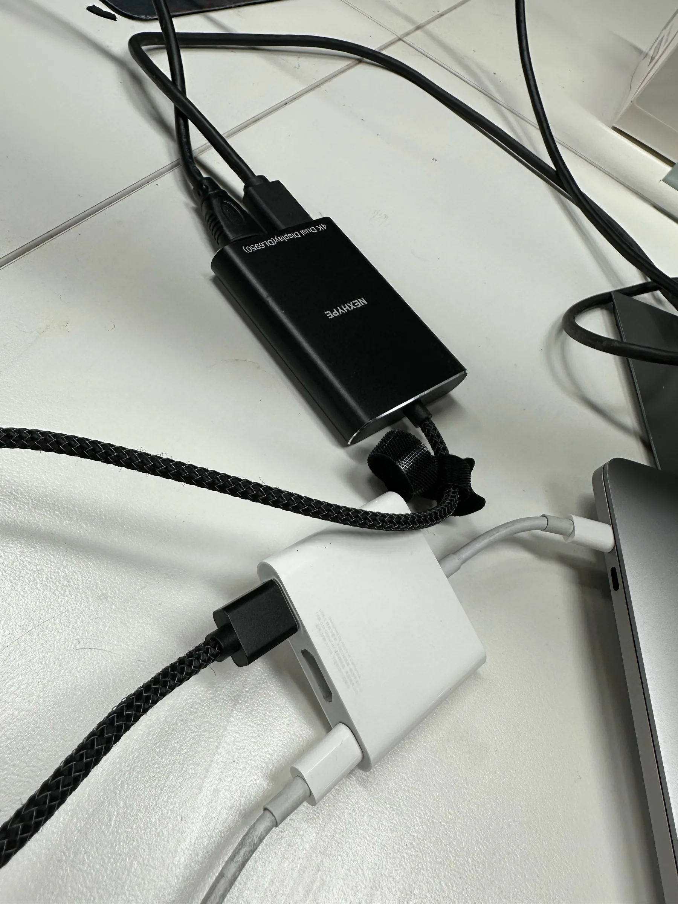
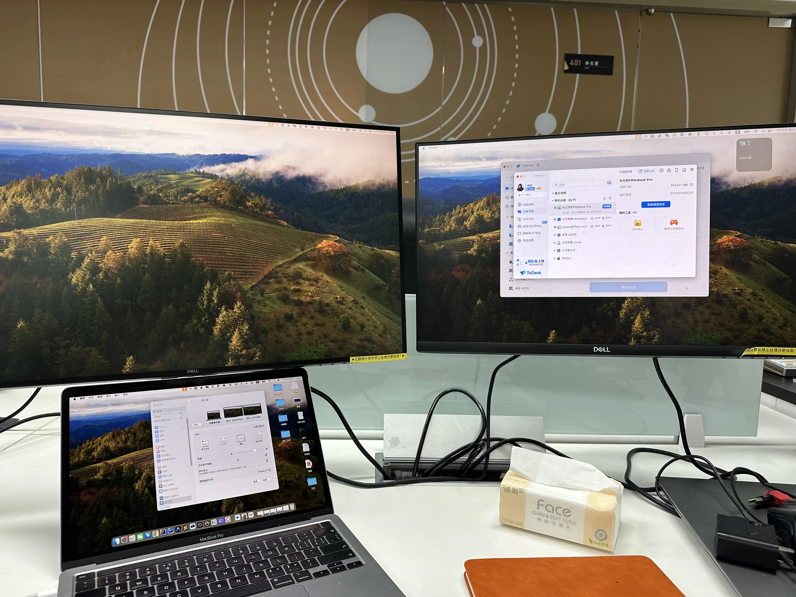

先说结论：**DisplayLink 的双屏拓展坞，以后绝不能再用了。**

不是嫌贵，也不是接口不够。是真卡。

## 刚开始，真香

办公室工位两台 Dell 显示器，笔记本只有几个 USB-C。买了一个 NEXHYPE「4K Dual Display (DL6950)」拓展坞，一根线进去，两根 HDMI 出来，系统设置里立刻多出两块外接屏。

那时候觉得自己赚到了：不用换电脑、不用折腾雷电坞，双屏办公、一边写代码一边挂远程，桌面一下子宽敞起来。

## 用久了，才发现是真卡

蜜月期过了之后，问题一点点露出来。

光标在外接屏上偶尔会顿一下；拖窗口跨屏时，像被什么东西拽着；看视频、滚长文档，偶尔掉帧。最烦人的是开 ToDesk 远程桌面的时候——外接屏本身已经在做软件合成，再套一层远程画面，延迟和卡顿叠在一起，用起来特别别扭。

这些卡，不是偶尔卡一下能忍的那种，是**每天都在提醒你：画面不是原生出来的**。

你明明已经接了双屏，人却一直被那一点迟滞拽着，注意力被一点点磨掉。

## 换成 Mac mini 之后

后来工位换成了 Mac mini。

它自带一个 HDMI，正好接一台显示器；再用官方的 USB-C Digital AV Multiport Adapter 出一路 HDMI，接第二台。两路都是原生输出，没有 DisplayLink 驱动在中间掺和。

效果立竿见影：**一点都不卡。**

光标跟手，拖窗干净，远程桌面也顺了。同样是双屏，体感完全是两回事。

## 为什么 DisplayLink 会卡

简单说一句原理就够了。

真正的雷电 / DisplayPort Alt Mode，是把显示信号直接从 GPU 送到显示器。而很多「一根 USB-C 出双 HDMI」的拓展坞，用的是 **DisplayLink**：把画面在电脑里先用 CPU/GPU 压成压缩流，再走 USB，到了坞里再解码画到屏幕上。

等于多了一层「软件合成」。USB 带宽、驱动调度、压缩质量，随便哪一环吃紧，你就能感觉到卡。双 4K、高刷、远程桌面一叠加，更明显。

所以它不是「坏了」，是这条技术路线本身就在用软件硬扛显示输出。刚开始能用、看起来香，用久了才会发现账是这样结的。

## 再也不用了

不是所有拓展坞都有问题。USB 集线、网口、读卡都很好用。

但凡是靠 DisplayLink 硬出双屏的，对我来说已经出局。能走原生 HDMI / DisplayPort / 雷电就走原生；实在要扩展，也优先选不靠软件合成那一路的方案。

双屏是为了更顺，不是为了每天跟延迟较劲。

**DisplayLink 双屏，下次不会再买了。**
