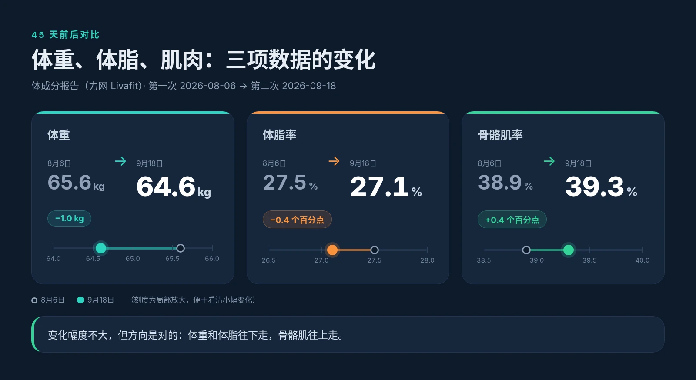
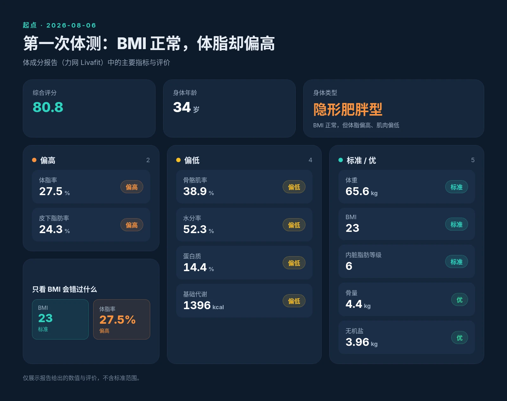
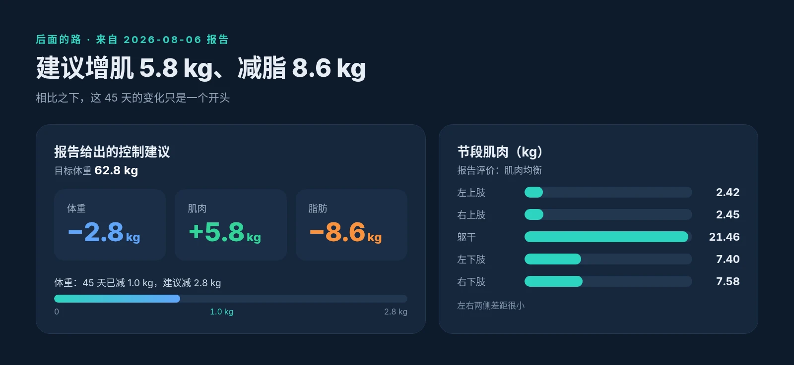

这 45 天里，我在健身房上了 5 节私教课。

除了健身房，平时的运动也都不复杂：周五和周末的晚上，去公园快走；每周用 Keep 骑行一两次，每次 15 到 20 分钟；再跟着 Apple Fitness+ 上课，大概一周一次，平均每次 10 到 15 分钟。

第一次体测是在 8 月 6 日，第二次是在 9 月 18 日，用的都是力网（Livafit）的体成分秤和报告。两份报告放在一起，就是我这 45 天的一张成绩单。

## 先看结果

- 体重：65.6 kg → 64.6 kg，减了 1.0 kg
- 体脂率：27.5% → 27.1%，降了 0.4 个百分点
- 骨骼肌率：38.9% → 39.3%，升了 0.4 个百分点

老实说，这些变化都不大。体重只少了 1 公斤，体脂率和骨骼肌率也只动了零点几。但方向是对的：脂肪在往下走，肌肉在往上走。对我来说，这比体重单纯掉了多少更重要。

## BMI 正常，不代表身体没问题

真正值得多看几眼的，是 8 月 6 日的第一份报告。

那次我的体重是 65.6 kg，BMI 是 23，评价都是标准。如果只看这两个数字，我大概会觉得自己还行。

但同一份报告里，体脂率 27.5%、皮下脂肪率 24.3%，都是偏高；骨骼肌率 38.9%、水分率 52.3%、蛋白质 14.4%、基础代谢 1396 kcal，都是偏低。报告给出的身体类型，是“隐形肥胖型”。

也就是说，从体重和 BMI 看一切正常，身体里面却是脂肪偏多、肌肉偏少。那次的综合评分是 80.8，身体年龄 34 岁。BMI 只能说明一部分问题，体脂和肌肉的数字，才更接近真实的情况。

当然，报告里也有让人稍微放心的地方：内脏脂肪等级 6，属于标准；骨量 4.4 kg、无机盐 3.96 kg，评价都是“优”；四肢和躯干的肌肉分布也比较均衡。

## 后面的路还很长

第一份报告还给出了控制建议：目标体重 62.8 kg，体重减 2.8 kg，其中肌肉增加 5.8 kg，脂肪减少 8.6 kg。

对照这 45 天的变化，体重减了 1 kg，离建议的 2.8 kg 还有一段距离；增肌 5.8 kg、减脂 8.6 kg，更是一个需要长期去做的目标。这组数字让我很清楚：这不是一个多月就能解决的事，先把方向保持住，比追求速度更实际。

## 小而能坚持的运动

回头看这 45 天，我做的事情其实很简单：5 节私教课，加上公园快走、Keep 骑行和 Fitness+ 课程。除了私教课，每一项单拿出来时间都不长，骑行十几二十分钟，Fitness+ 十来分钟，但它们容易安排进日常，也就更容易坚持下来。

这次的成绩单不算亮眼，但它至少说明，这些小而能坚持的运动是有用的。接下来，我会继续按这个节奏走下去，让这些数字慢慢往对的方向移动。
