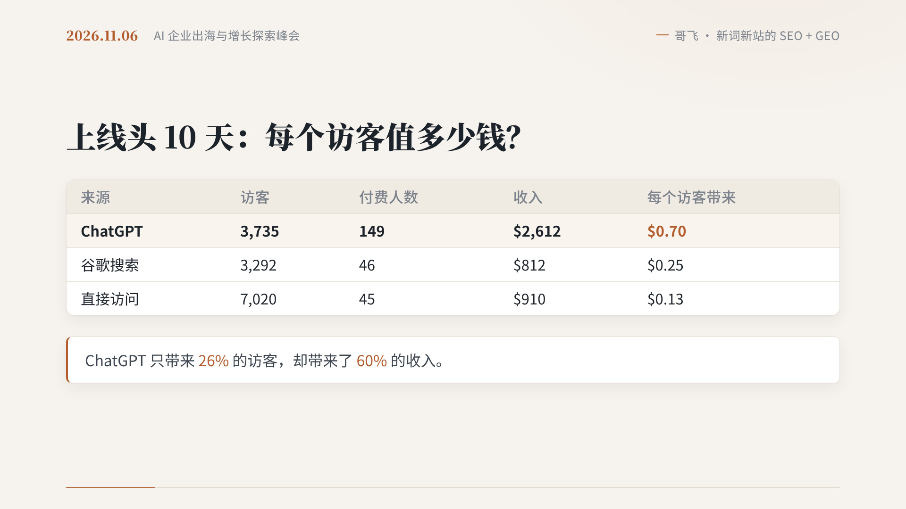
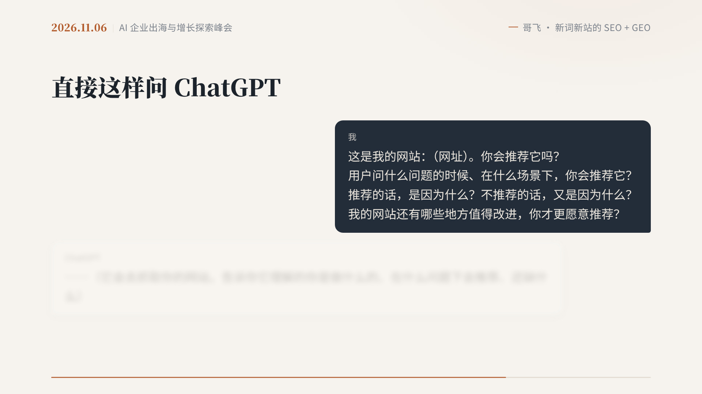
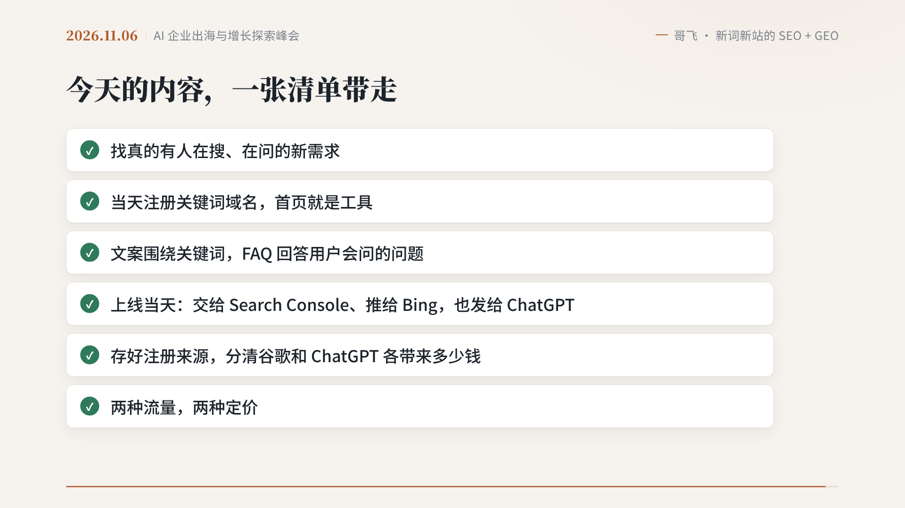

写了七年 Java，在南京做后端，平时也在做面向海外的游戏攻略站和工具站。流量这件事，我之前想得更多的还是谷歌：找词、收录、排名。

但最近越来越常听到另一个入口：用户不去搜，而是直接去问 ChatGPT。前几篇写线下分享时，我也记下过，AI 搜索往往最先见效，而且在 App 里点过来的访问，常常会被算成「直接访问」。

11 月 6 日，哥飞在上海「AI 企业出海与增长探索峰会」上做了一场主题分享，题目是《新词新站，如何同时拿到 SEO 和 GEO 流量》。GEO 在这里的意思很具体：让 ChatGPT 这类 AI，在回答里推荐你的网站，给你带来访问。

我对照这次分享，把笔记整理下来，不是要把 175 页 PPT 再讲一遍，而是留下对我来说最有用的几件事：为什么 ChatGPT 愿意给新站流量，怎么做，以及我接下来准备试什么。

11 月 11 日，哥飞又在 X 上发了一条推，说 OpenAI 正式发布了 Business In ChatGPT。这件事刚好接上：以前我们多半只能在自己的统计里猜，ChatGPT 有没有推荐自己；以后认证商家也许能像用 Google Search Console 一样，看到产品被提到了多少次。

## 先看一个例子：流量来得快，也走得快

哥飞先讲了自己 9 月 28 日上线的一个 AI 视频新站。上线第一天来了 600 个独立访客，成交 17 单，收入 221 美元。这些付费用户全部是 ChatGPT 推荐过来的。这个站没有发过外链，也没有投过广告。

到分享时，这个站大约有 1.7 万个独立访客，其中 4600 个来自 ChatGPT，3700 个来自谷歌，总收入 6100 多美元，ChatGPT 带来的最多。

把头 10 天按来源拆开，数字更清楚：

ChatGPT 来了 3735 个访客，149 个人付了钱，每个访客大约 0.70 美元；谷歌来了 3292 个访客，每个访客 0.25 美元。ChatGPT 只占了 26% 的访客，却带来了 60% 的收入。

但还有另一面。这个站踩中的是 TikTok 上的一个 AI 视频热点。9 月 29 日热点刚起来时，ChatGPT 一天带来一千多个访客；热点过了高峰，流量每天大概掉三分之一。两周以后，ChatGPT 一周只剩 123 个访客，谷歌一周还有 352 个访客、10 个人付费，谷歌反而成了主要的付费来源。

哥飞把这句话说得很干净：**ChatGPT 是来得快、去得也快的增量，谷歌是留得住的基本盘。**

对我这种更习惯做谷歌 SEO 的人来说，这既是提醒，也是安慰。不是要放弃谷歌，而是多一条腿。

他后来又做了两个新站，也拿到了 ChatGPT 的流量。其中一个还说明了速度：ChatGPT 的爬虫一次把页面收录进去，两个小时后，第一个访客就来了。另一个站里，用 Bing 索引的 Bing、DuckDuckGo、Yahoo 加起来，访问比谷歌还多。所以后面会反复提到：上线当天，别只交给谷歌。

## 为什么新站也有机会

新词新站的打法，哥飞总结得很短：发现一个刚冒头的新词，当天用这个词注册域名，当天上线一个首页就能满足需求的网站，然后拿谷歌和 ChatGPT 的流量，出单。

原因也不复杂。老词的前排早就被大站占住了，新站要拼权重、拼外链、拼时间。新词竞争几乎是空的，而且一个全新的需求，只能由全新的网页来满足。

国庆期间，社群做了一次集体实验。9 月 28 日到 10 月 8 日，有 49 位群友上线了新词新站，并且都出了单。其中 41 位在复盘里提到了 ChatGPT 带来的流量，二十多位的第一单、或者大部分订单，就是 ChatGPT 推荐来的。当然，也有群友的流量绝大部分来自谷歌。两边都有机会。

更值得记下的，是背后的逻辑。

谷歌愿意给新站流量，是因为它要满足各种新的、甚至稀奇古怪的搜索。对新网站，它会先给一些展示机会，再看用户会不会点、会不会用、用完会不会回到搜索结果里再找别的。对新需求，它只能靠新网页；对老需求，它也在找做得更好的新页面。

把这个循环里的「谷歌」换成「ChatGPT」，依然成立。用户现在也会带着需求去问 ChatGPT。老需求，它会抓老网站，也会抓新网站；全新的需求，它能抓到的，往往只有刚做出来的新网页。

哥飞这一年观察到的 ChatGPT，有几个很具体的特点：

- 爬虫是真的会来。OAI-SearchBot 负责收录；用户提问时，ChatGPT-User 还会当场打开你的页面，网站后台看得到。
- 一收录，流量就可能来。有的站是几个小时后开始被推荐。
- 它不看网站权重，也不看大家常说的 DR。它看的是：你的这个页面，能不能回答用户这一次的提问。
- 所以新词新站拿 ChatGPT 的流量，并不依赖外链，成本很低。

当然，他也说了另一句很重要的话：现在还有运气的成分，同样的动作，有的站拿到了推荐，有的没有。推荐还会波动，不能把某一天的量当成稳定收入。速度也很关键，上站晚了几天，那个新词在 ChatGPT 那边的位置，可能已经被别人占了。

## 怎么同时拿到两边的流量

社群验证过的做法，是一套同时交给两边的动作，一共六步。

**第一步，找需求。** 谷歌这边，在谷歌趋势里找刚冒头的新词。ChatGPT 这边，可以用 SimilarWeb 这类工具，看 ChatGPT 把流量导给了哪些网站。别只看大站，去看排在很后面的小站，它们满足的是什么需求。找到词以后，再去 ChatGPT 里问一问，看它现在推荐哪些页面、做对了什么。前提只有一句：真的有用户在问。没人问的需求，做得再好也没有流量。

**第二步，建站。** 直接用关键词注册域名，一个词一个站，首页只做这一件事，打开就能用。ChatGPT 会优先推荐完全匹配需求的页面。另外，一个功能最好单独做一页。有群友实测：只给首页，ChatGPT 认不出某个功能；补上内页，它才说得清，推荐时还会直接链到那个内页。

**第三步，写页面。** 这几条，谷歌和 ChatGPT 两边都吃：文案围绕关键词，让整个页面聚焦在一件事上；用 FAQ 把用户会问的问题回答完，比如怎么做、多少钱、能不能免费；页面要服务端渲染，爬虫一打开就能看到正文；检查 `robots.txt` 和 Cloudflare 的设置，别把 AI 爬虫挡在门外。至于 `llms.txt`，哥飞的判断是加不加区别不大，不是关键。

什么样的页面更容易被推荐？哥飞用自己站上的数据做了对比：泛泛的问题，或者常青大词，ChatGPT 要么自己回答，要么直接推大工具，这类页面一个访问都没有。拿到访问的页面，名字往往就是那个新梗、那个具体任务。用户怎么问，标题就怎么写；前两句话直接回答：是什么、在这儿怎么做、多少钱。

还有一组数字我也记下了：落在工具页的 ChatGPT 访客，1041 个里有 54 个付费；落在教程页的，130 个里只有 1 个。教程负责被引用，工具页负责成交，教程第一屏最好链到工具页。

**第四步，上线当天，三个地方一起交。** 谷歌交给 Search Console，提交网站和 sitemap。Bing 这边用 IndexNow 把新页面推过去，再在 Bing Webmaster Tools 里提交 sitemap。ChatGPT 这边的做法简单到让人有点不敢信：把网址发给它，直接问。

哥飞给的问法是：

> 这是我的网站：（网址）。你会推荐它吗？用户问什么问题的时候、在什么场景下，你会推荐它？推荐的话，是因为什么？不推荐的话，又是因为什么？我的网站还有哪些地方值得改进，你才更愿意推荐？

它会去抓这个网站，然后告诉你它理解的你是做什么的，在什么问题下会推荐，还缺些什么。照着改，改完再问一遍。

这一步为什么要连着 Bing 一起做？哥飞自己站上的数据是：有几个新页面，ChatGPT 一个访问都没有，后来发现是 IndexNow 没配好；修好推给 Bing，当天就来了。之后每个新页面，推给 Bing 大约一天，第一个 ChatGPT 访客就来了。另一个站如果 Bing 一直没收，就只能等 ChatGPT 自己的爬虫，等了 3 天。

他另外还有一个三步法：先反问 ChatGPT，假如你是用户，想找这类工具会怎么提问，拿到一份问题清单；再另开窗口，一个一个问，看它抓了哪些网页；最后把结果交给 AI，让它告诉你页面该补什么。有群友实测，跟 ChatGPT 介绍过网站之后，新开对话、不带网址去问，回答里就出现了他的网站和功能页链接。

**第五步，看数据，别让 ChatGPT 的流量「隐身」。** 在 ChatGPT App 里点开链接，经常不带来源，统计里会被算成直接访问。要看 `utm_source=chatgpt.com` 的访问，这是推荐链接后面常带的来源标记。最好在用户注册时就把来源存下来，一笔一笔对订单，才知道哪个渠道真的在赚钱。

**第六步，变现。** 群友们的观察是，两种流量最好用两种定价。ChatGPT 来的用户付费率往往更高，但大多是一次性的小额付费；谷歌来的用户付费率相对低一些，但更愿意接受高价；Bing 的用户，比谷歌的还更愿意接受高价。这些是各自站点上的观察，不是行业统计。哥飞的理解是，三个入口背后的人也不太一样：ChatGPT 更偏年轻，谷歌是全年龄段，Bing 更偏年长、客单价更高，但最讨厌意外收费，价格要一次说清楚。

## 一张清单，加上一个新变化

分享最后，他把当天的内容收成一张清单：

- 找真的有人在搜、在问的新需求
- 当天注册关键词域名，首页就是工具
- 文案围绕关键词，用 FAQ 回答用户会问的问题
- 上线当天：交给 Search Console、推给 Bing，也发给 ChatGPT
- 存好注册来源，分清谷歌和 ChatGPT 各带来了多少钱
- 两种流量，两种定价

他的判断是：2023 年，群友们的机遇是从谷歌拿到 AI 新需求的流量；2026 到 2027 年，最大的新增机遇，是从 ChatGPT 拿流量。谷歌这个基本盘，照样要守好。

11 月 11 日，哥飞在 [这条推](https://x.com/gefei55/status/2120307701872029825) 里写道：前几天大家就在讨论，ChatGPT 版的 Google Search Console 要来了。当天 OpenAI 正式发布了 Business In ChatGPT，核心是通过 Business Hub，让认证的商家知道自己的产品被 GPT 提及的情况。它还支持创建 Business Agents，让用户直接与商家对话，不过这个暂时只支持美国的电商和在线服务商家使用。

他在回复里又补了两张官方示意图，并说「看图二，功能还挺多的」。图一是 Brand insights：能看到提及次数、主页浏览、网站点击，以及用户是在哪些主题下发现你的。图二则是对话里直接出现商家卡片，用户可以查看网站，也可以开始聊天。

具体功能以 [OpenAI 的官方博客](https://openai.com/index/introducing-businesses-chatgpt/) 为准。对我来说，眼下最有感觉的是前半句：以后也许能更清楚地看到，自己有没有被 ChatGPT 提到、在什么问题上被提到。至于 Business Agents，目前还只开放给美国的部分商家，我先记下，不等待。

## 我准备先试的几步

听完这些，我没有觉得自己马上就能复制那组数字。那是哥飞和群友在新词窗口里跑出来的结果，而且 ChatGPT 的推荐本身就会波动。

我更想先把自己站点上能做的事情补齐。

第一，检查现有站点的 `robots.txt` 和 Cloudflare 设置，确认没有把 OAI-SearchBot、ChatGPT-User 挡在门外。

第二，下一次上线或者更新页面时，不要只提交 Google Search Console，也把 IndexNow 和 Bing Webmaster Tools 一起做掉，然后再把网址发给 ChatGPT，按上面那组问题问一遍。

第三，在统计和用户记录里补上来源。至少能分开看 `utm_source=chatgpt.com`，也提醒自己：直接访问里，可能藏着一部分 App 里点过来的 ChatGPT 流量。

这几步我先做起来，再看结果。谷歌还是基本盘，但 ChatGPT 这条增量，我不想再只停留在「听说很重要」。
