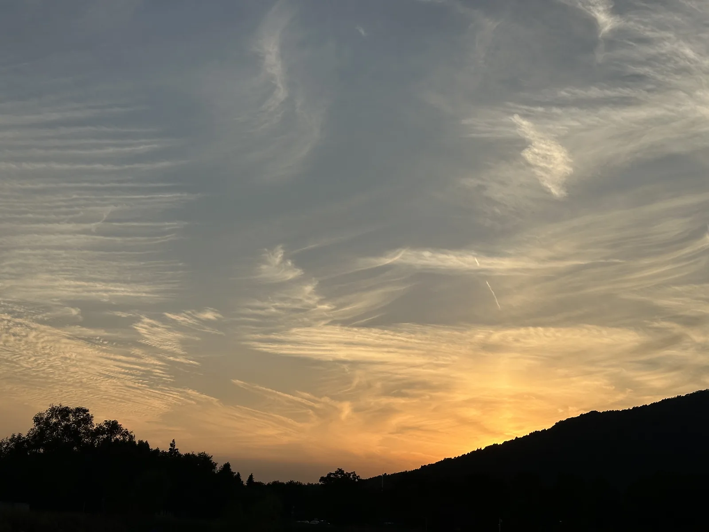

为期4天的国庆假期正式进入倒计时，明天又要重返“牛马”生活。

这几天城市里一直阴雨连绵，直到假期的最后一个下午，才总算拨云见日，看到了久违的太阳。

今天上午，老婆一家从老家过来，大家聚在一起聊聊天、吃吃饭，短暂的热闹后又是分别。回看手机里家族群的热火朝天，这个国庆没回老家，心里终究还是有点遗憾和懊悔。人有时候就是这样，越长大显得越有些矫情，对很多聚散离合总是无法轻易释怀想明白。

送走他们后，看下午有了阳光，我本打算去先锋书店坐坐，静下心来梳理下手头那几个网站项目的后续规划。但节假日的人潮汹涌实在超出了预料，矿坑公园仿佛被“火星人”占领。在拥挤的书店里，无论是微弱的Wi-Fi还是几乎瘫痪的手机网络，都差到连网页也打不开。想做点事情的计划，就这么被外部环境无奈搁置了。

只好作罢，带着老婆转道去了附近的金乌公园。

这里是一番截然不同的景象。避开了打卡的人群，公园里多是散步的老年人和遛娃的家长。我们并肩坐在长凳上，看着夕阳余晖下爷爷奶奶们载歌载舞，那一刻，之前在书店里因为断网和喧闹带来的急躁，突然就被抚平了。我不禁在想，人这一辈子忙忙碌碌，到底是为了什么？

恰巧旁边有一家三口在互相拍照，小女孩正调皮地对着镜头摆出各种姿势，笑声清脆。看着他们，我心里突然冒出一个很强烈的念头：我想有个孩子了。毕竟我和老婆终会老去，我们的人生需要这样鲜活的新生命，来让未来的日子继续明亮起来。

夜幕降临，思绪又被拉回现实。心里其实一直无法接受国庆假期还要加的那三天班，脑子里也不自觉地盘算着，眼下的岗位也许最多也就只能干到40岁。过了40岁以后，我又该做点什么？

假期结束了，生活还要继续。希望在接下来的3年、5年里，我能在这个充满焦虑与变化的世界里，真正找到属于自己的那条出路。
