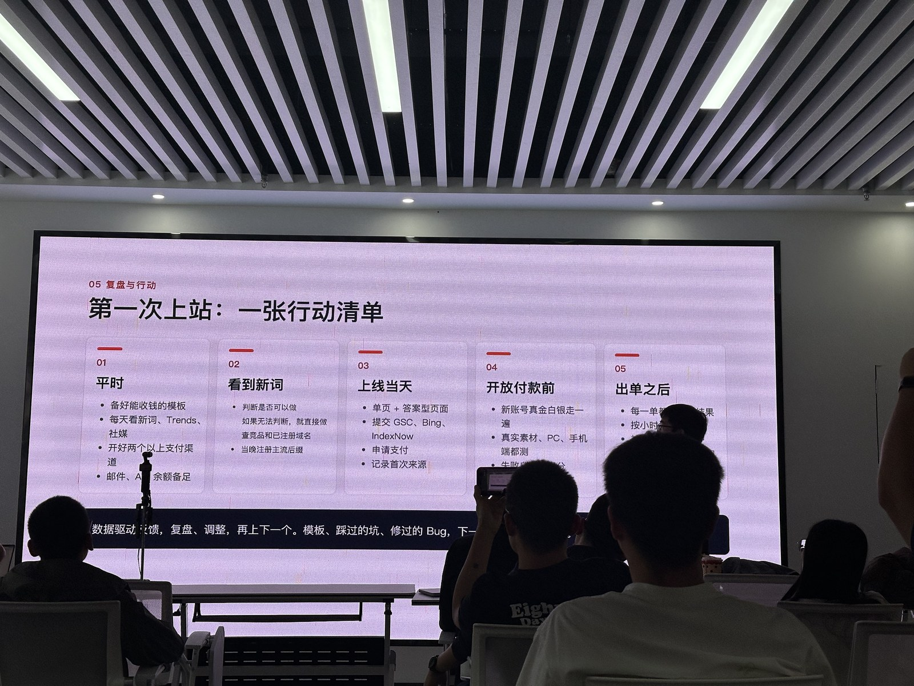

写了七年 Java，在南京做后端，现在也在折腾面向海外的游戏站和工具站。我并不是完全没有拿到反馈：目前流量最好的 crimsondeserthq.com，近 28 天在 GSC 里大约有 1530 次点击。

但有流量，和跑通生意，还是两回事。新词 → 上线 → 流量 → 收款，这条路我还没有完整走通。

听完《阿飞·实战笔记》和《新手上站行动手册》这两场分享，留下来最深的一句话是：**坑不在能力，在顺序。**

一个讲为什么迟迟没有结果，一个讲怎么把第一站做起来。放在一起看，刚好也让我重新想了想：我现在最该解决的，究竟是哪一步？

## 会写代码，不等于先写代码

作为工程师，我很容易先想技术栈、部署、模板和自动化。这些事熟悉，也容易得到「今天做了不少」的满足感。

但用户不会因为我把架构搭得漂亮就付款。

分享里提到，把 80% 的精力放在找词上，先用最丑的单页测试需求，有了流量数据再做基建。我的理解不是模板完全不该准备，而是别让准备工作变成主线。能复用的底座够用就好，这一站值不值得做，得让真实需求来回答。

把这次提到的五个坑对照自己，我更愿意把它们当成五个问题，而不是听完就拿去评价别人。

### 1. 我是不是把顺序弄反了？

还没确认谁需要，就开始考虑系统怎么扩展，这是工程师很容易有的惯性。我也需要提醒自己：现在这个功能，是用户要的，还是我觉得做起来很舒服？

### 2. 我是在做判断，还是一直拖着不决定？

方向怕竞争大，域名怕不好记，框架怕选错。每个顾虑单独看都有道理，叠在一起就可能一直没有第一版。

对我来说，更有用的问题是：能不能先做一个可回退的小尝试，而不是一次把所有事情想明白？

### 3. 我是不是把新词和老词当成了非此即彼？

分享里的思路是，新词适合快速练闭环，老词适合长期积累。前者可能很快拿到反馈，也可能热度转瞬即逝；后者需求更成熟，但竞争和积累周期也更长。

这和我之前想往订阅制 SaaS 走并不矛盾。先用一个小需求练习收款与交付，不代表以后只追热点。练习闭环和选择长期方向，可以是两件事。

我也不想把「几天有反馈」当成保证。具体多久有效，还是要看需求、竞争和实际执行。

### 4. 我是不是拿熟悉领域的经验，代替了 SEO 的基本功？

短视频的推流，不等于搜索的意图匹配。开发经验也不能直接替代对收录、搜索结果页和外链的理解。

即便已经拿到一些点击，我还是得保持新手心态。用户搜这个词到底想完成什么，Google 展示了哪些页面，为什么会点我的站，这些问题不能省。

### 5. 我是在提效，还是在用基建缓解焦虑？

自动找词、监控趋势、给候选词打分，听起来都很适合程序员。但如果手动都判断不清一个词，自动化也只是把不清楚的判断批量执行。

分享里「十几套基建，零个网站起来」的反差很扎心。这不是我的成绩单，却是值得提前贴在桌边的提醒：**先亲手跑通，再考虑怎么批量做。**

## 为什么我还是愿意去线下

之前写线下聚会时，我就觉得，听别人真实做过什么，比一个人闷头想方向有用。

这次也是一样。在线上看教程，很容易每一句都懂，合上电脑却不知道下一步干什么。真正打开搜索结果页、找一个词、把页面部署出去，才会发现自己卡在哪里。

我理解的线下价值，不是听完就比别人多了一套秘诀，而是把「我懂了」变成一个更具体的问题：这一步你做过没有？没做过，就现场做一次。

对我来说，接下来需要增加的不是收藏夹里的资料，而是真实操作之后能拿出来讨论的问题。

## 把六个关卡，留在动手时看

完整渠道和操作很多，我不想把这篇写成一份课程讲义。但下面这张表值得留下来，等自己上站时逐项核对。

原则很简单：**哪一关没过，先解决哪一关，不要拿下一关的忙碌掩盖上一关的问题。**

| 关卡 | 要回答的问题 | 过关标准 |
| --- | --- | --- |
| 选词 | 最近有什么正在冒头的需求？ | 找到 1—3 个近 7 天开始起量的候选词，保留出处与时间。 |
| 判断 | 值不值得现在做？ | 检查真实需求和竞争、用户进站理由、自己的交付能力；硬门槛不能跳过。 |
| 上线 | 能否赶上窗口？ | 以 24 小时内上线可付款、可交付的第一版为目标，不为完美拖延。 |
| 流量 | 用户和搜索引擎能否找到？ | 提交收录，上线答案型页面，验证统计正常；提交不等于已经收录。 |
| 转化 | 用户是否愿意付钱？ | 记录访问到付款的漏斗，拿到真实第一单，而不是只完成支付配置。 |
| 交付与复盘 | 付钱后能否兑现，账能否算清？ | 稳定交付，扣除 API、托管、手续费和退款后，判断继续、调整还是换词。 |

找词渠道我也压缩记一下，免得每次只盯一个工具：

1. 社媒热门搜索、视频和讨论，抄下用户原词，再去 Google 验证。
2. SteamDB、IGDB、itch.io、Roblox、Hugging Face、GitHub 等平台的新增与增长信号。
3. generator、calculator、guide 等任务词根，结合 Google 下拉词扩展。
4. Google 关键词规划师、Similarweb、Ahrefs、Semrush 等工具扩词。
5. 反查竞品的获客渠道和热门页面，找能改进的小需求。
6. 从产品榜和收入榜倒推用户任务，不只盯品牌名。
7. AI 定时扫描明确的来源，保留时间与数据，人来判断。
8. 从自己 GSC 的真实搜索词里挖新需求，决定补页还是优化原页。
9. 供词服务先看样例、核实数据和使用条件，不直接照单全收。

判断时，我想尤其记住三个检查：搜索前十名是谁；AI 摘要之后用户还有没有点击理由；资料、功能和成本是否支持我把承诺兑现。

如果用户需要上传、计算、交互，可能还有进站的理由，但这只是需要验证的假设，不是看到一个工具词就默认有生意。

至于上线，底座确实要备好：登录、支付、失败退积分、交付下载、来源记录，以及条款和隐私页。邮件、支付与生成 API 也要有可用的备用方案和余额提醒。只是准备到能支持这次验证就行，不用一开始把所有能力都塞进去。

上线前清掉旧品牌、旧域名、占位文案和虚构评价，检查密钥有没有暴露；用正式网址在手机和电脑上走一遍。基础检查还包括主域名跳转、canonical、robots、noindex、GSC、sitemap，以及 GA4 实时事件。

流量也别只等 Google：可以补答案型页面观察 AI 搜索，相关老站加入口，再到真正需要的人群里分享真实案例。AI 推荐不保证马上见效，直接访问也不能一概归因为 AI。要试搜索广告，就先算清单均获客成本和毛利。

有访问没注册，先看首屏与意图；有注册没上传，先看流程与移动端；看到付费墙没付款，再看定价和步骤。**访问 → 注册 → 上传素材 → 看到付费墙 → 付款**，适合生成工具的这条漏斗，要配合首次来源、UTM 和落地页一起记；别的站型则按自己的实际流程调整。

## 五天，不是五天保证出单

我想拿这张训练表约束自己。重点不是周五必须赚到钱，而是到周五能拿出一组真实观察，而不是一堆「我觉得」。

| 天数 | 练什么 | 留下什么 |
| --- | --- | --- |
| 第一天 | 词找站：看上线一周到一个月的新站 | 候选词、站点与增长证据。 |
| 第二天 | 站找词：反查这些站的词根和细分需求 | 缩小到一个值得验证的任务。 |
| 第三天 | 数据分析：拆流量路径和外链 | 写清用户可能从哪里来，判断依据是什么。 |
| 第四天 | 极简单页：只完成核心任务 | 一个能访问、能测试交付的页面。 |
| 第五天 | 看真实数据，复盘卡点 | 决定补什么、继续观察，还是停止投入。 |

五天只是训练周期，不是 SEO 见效周期。没有数据时先查收录和分发，也要考虑样本和观察时间，不能把短期没动静直接当成需求不存在。

## 第一次上站，我会照这五步核对

- **平时准备：** 留一套够用、能收钱的模板；持续看新词和社媒；准备支付备用渠道、邮件与 API 余额。
- **看到新词：** 查需求、搜索结果、竞品和域名。拿不准时可以做低成本小验证，但不能跳过合规、成本和交付能力的检查。
- **上线当天：** 核心单页和答案型页面上线，提交 GSC、Bing；适用时用 IndexNow 通知支持它的搜索引擎，并记录首次来源。
- **开放付款前：** 用新账号在电脑和手机上完成真实支付测试，验证真实素材、交付与失败退积分，避免只看接口返回成功。
- **出单之后：** 每一单都核对交付结果，再按漏斗查卡点。有流量没订单就查转化，没流量就查分发，热度退了就控制追加投入；跑通了也别急着堆功能。

写到这里，我觉得这两场分享最值得带走的，还是那个顺序。

我不需要先证明自己能搭多复杂的系统。下一步，选一个新词，按这张五天表认真跑一次。先把找词、上线、流量、付款和交付连接起来，再想怎么放大。

等做完，再写一篇真正带着数据和卡点的复盘。哪怕结果不好，也比再收藏十篇教程更有用。

**先跑一遍，再谈熟练。**

> 本文是听完《阿飞·实战笔记》与《新手上站行动手册》分享后的个人整理和反思。五个坑、六关流程与训练清单的思路来自分享内容，感谢分享者。文中的行动安排是我给自己的练习，不是收益或见效时间的承诺。配图为现场照片。
