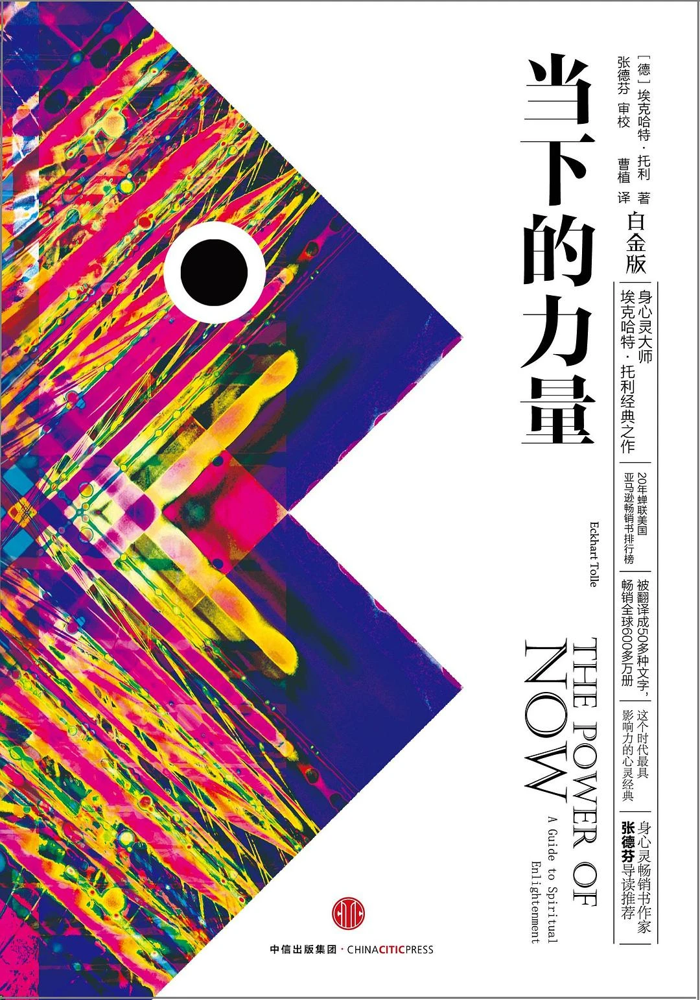

> 这是粥左罗第二期读书会的第八本书。这本书其实也不好读，翻来覆去就是来论证书名。

## 一、概述
《当下的力量》是埃克哈特·托利最具代表性的作品之一，也是一部广受欢迎的心灵成长读物。它围绕一个核心问题展开：为什么我们明明在过当下的生活，却总被过去的遗憾和未来的焦虑牵着走。

书中指出，许多痛苦并非来自事件本身，而是来自我们对思维的过度认同——反复回忆、不断预设、持续内耗。托利提出，真正的转变不在“想得更明白”，而在“回到当下”：把注意力放回此时此刻，减少无意识的心理反应，从而获得更稳定的内在状态。

《当下的力量》并不只是讲理念，也提供了可实践的方向：如何观察自己的思维、如何接纳当下、如何在日常关系与压力中保持觉察。对于长期处在焦虑、压力和情绪消耗中的现代人来说，这本书提供了一条更可落地的路径——把生活从“被思维推着走”，慢慢转向“清醒地活在当下”。

## 二、金句摘抄
### 痛苦的来源与机制
- 制止不住大脑的思考，是让我们受苦的主要原因。
- 不幸和恐惧最终都是大脑制造出来的。
- 关系本身不会造成痛苦和不快乐，它们只是将已经在你内在的痛苦和不快乐引发出来。
- 所有沉溺上瘾都源于你无意识地拒绝去面对和经历痛苦。
- 人类的很大一部分痛苦是没有必要的。
- 佛陀说人类的痛苦源于欲望或贪婪，如果你要摆脱痛苦，你就必须摆脱欲望。
- 你的痛苦有两个层次：现在产生的痛苦，以及过去产生的但现在仍遗留在你的思维和身体内的痛苦。
- 痛苦的程度取决于你对当下的抗拒程度以及对思维的认同程度。
### 思维与认同
- 思维是我们所拥有的最为贵重的天赋。
- 绝大部分人不具有创造性，不是因为他们不懂得如何去使用思维，而是他们不懂得如何停止思维。
- 只有停止思维认同，你的思维才会丧失它的力量，本体才会以你原来的本性显露出来。
- 消极心态没有任何作用。
- 一旦你有了一个理论，你就会很容易找到证据来证明它。
### 当下、接纳与压力
- 当你完全接受当下的事实，你生活中的所有戏剧性事件就会终结。
- 你越是接受当下，你受的苦就越少，也越能从小我思维中解脱出来。
- 实际上，当下才真正的珍贵。你越关注时间——过去和未来，你就会越多地错过当下。
- 压力的产生是由于你在“这里”却想到“那里”去，或你在当下却想去未来。
- 如果你正在做的事情无法让你感受到喜悦、自在和轻松，这并不意味着你需要改变你正在做的事情，你需要改变的是你做事的方式。
- 明天的账单不是问题，身体的衰老也不是问题，失去当下时刻才是真正的问题。
### 觉察与认知视角
- 黑暗无法认出光明，只有光明才能认出光明。
- 在日常生活中，不要百分之百地将你的注意力放在外部世界和你的思维上，请在内在保持一些注意力。
- 没有一件事是它表面看起来的那个样子。

## 三、总结
刚开始读这本书的时候，完全被书名吸引了。当时的我天天在畅想未来，很难脚踏实地去做当下的任务。但是读了前几页，我就感到振奋了，勉强能够去做该做的事情了。读到后面就感觉作者说话真费劲，弯弯绕绕的，断断续续读了一个多月才读完。

可能是自己的认知还不够，网上推荐这本书的不在少数，也许过几年重读会有不一样的感受。
