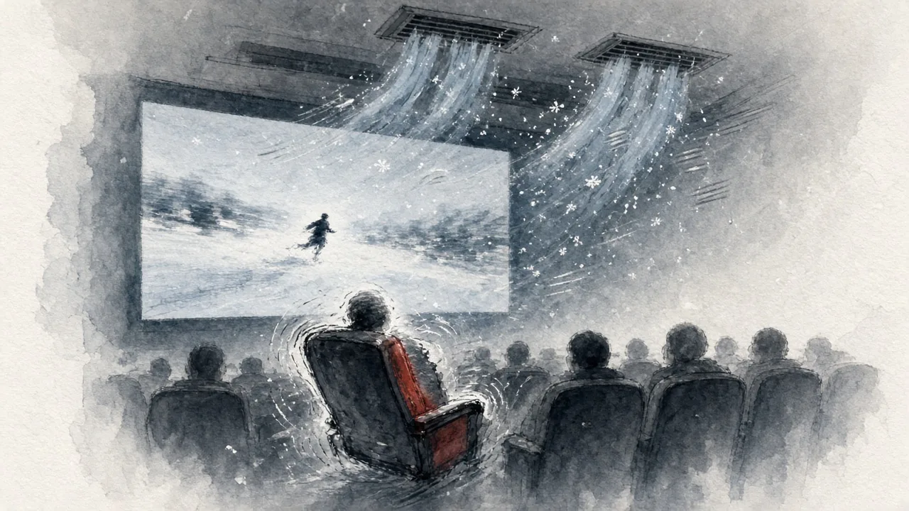
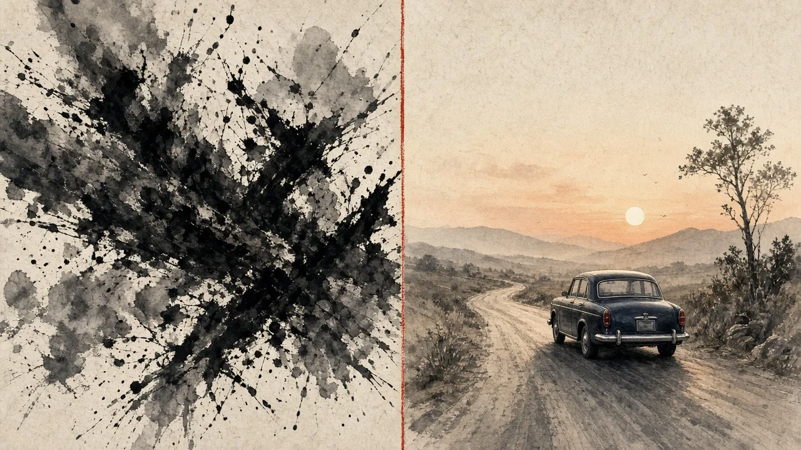

今晚是万圣节前夕，想着应个景，晚上去看了《生化危机：爆发夜》。

结论先放这儿：**大失所望。**

## 剧情一般，就是为了吓人

看完回想，剧情真的很一般。整部片子的核心目的好像就一个——吓你。突然冒出来、突然一声响，一个接一个，跟《怪奇物语》那种路子有点像。

吓是吓到了，但吓完就没了，脑子里留不下什么。

## 血腥暴力，看着恶心

更让我难受的是里面的血腥和暴力。不是那种"刺激"，是真的看着恶心，有几段我是真不想看下去。

可能有人就好这口，但我确定了，我不是。

## 像在看别人打游戏

整部电影给我的感觉，更像是第一人称游戏视角。镜头跟着人跑、躲、打，我坐在下面，就像在看别人打游戏。

很像以前跟朋友一起玩的《求生之路2》。区别是，玩游戏的时候手里有手柄、身边有朋友，紧张也是乐趣；而在电影院里，我只能干看着。

## 唯一值得推荐：4D 效果

要说有什么值回来的，就是 4D 观影体验。

座椅会跟着剧情摇晃、震动；主角在冰雪里奔跑的时候，座椅上方真的会吹冷气下来，那一下还挺出戏又挺入戏的。

如果你冲着 4D 去体验一下，倒也可以。冲着电影本身，就算了。

## 我更喜欢剧情片

看了《怪奇物语》系列，再加上今晚这部，我算是想明白了：**我更喜欢剧情类的电影。**

比如《绿皮书》。那种片子看完，会让人想很久，会引发思考，觉得这两个小时花得有意义。

而惊吓类的片子，看的时候心跳很快，散场之后就什么也不剩了。

以后选片，我大概会更诚实一点：别为了应节去凑热闹，挑自己真正喜欢的。
