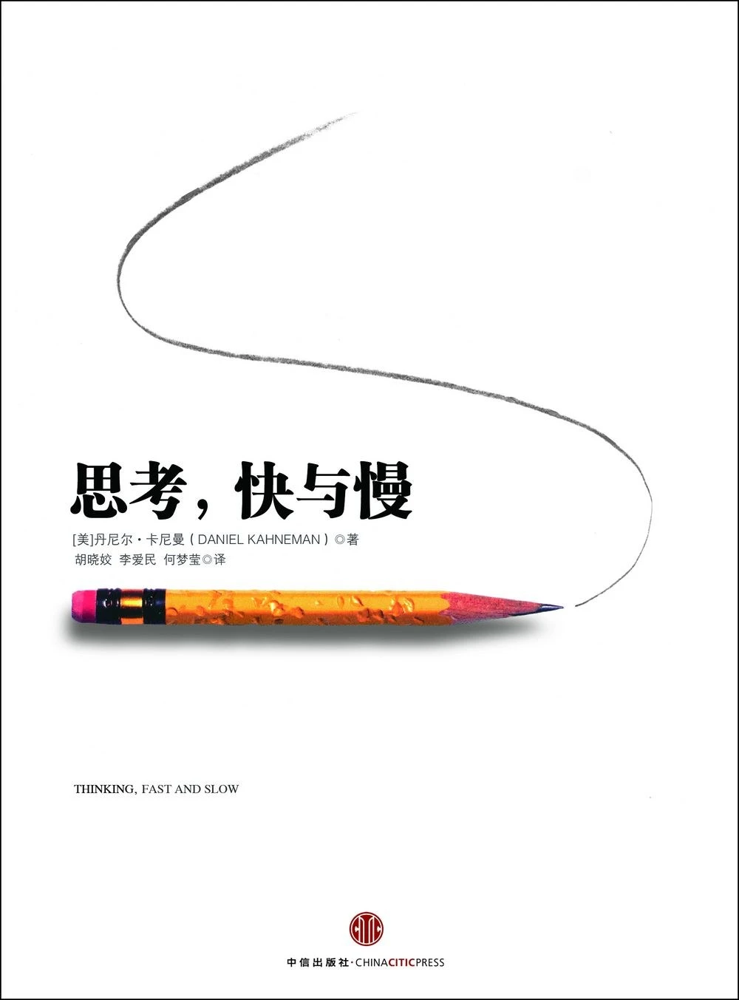

> 这是粥左罗第二期读书会的第十本书。这本书偏理论和说教，我也没读完。

## 一、概述
《思考，快与慢》是诺贝尔经济学奖得主丹尼尔·卡尼曼的经典作品，是卡尼曼一生研究工作清晰而富有启发性的总结。作为行为经济学和实验经济学的先驱者，卡尼曼的研究影响深远。

卡尼曼认为，有两种系统驱动着我们的思考和决策方式：系统1是依赖直觉、情感、记忆做出的快速判断；系统2则更慢、更深思熟虑，也更有逻辑。通过阐释这两个系统在大脑中的运作规律，卡尼曼揭示了快思考和直觉印象对人类思想和选择的普遍影响。他通过生动的对话和实验展示了我们什么时候可以信任自己的直觉，什么时候不可以，以及我们如何利用慢思考的优势，做出比传统经济学中的理性人更好的选择。

## 二、金句摘抄
### 2.1 系统1 / 系统2 与思维机制
- 事情变得困难时，系统2会接管思维活动，并拥有最终的决策权。
- 系统1是自动运行的，不能随意关闭，直觉思维的错误通常很难预防。
- 系统1产生的印象往往会转化为信念，它也是冲动的根源，那些冲动又会成为你的选择和行动。
- 系统1会制造出过分自洽的现实表征。
- 皱眉通常会提高系统2的警惕性，降低过度自信和对直觉的依赖。
### 2.2 认知偏差与判断错误
- 关注错误并不意味着贬低人类智慧，就像医学教材关注疾病并不意味着否定健康。
- 相比发现自己的错误，发现别人的错误更容易。
- 高智商并不能使人们免受偏差的影响。
- 光环效应加大了第一印象的重要性，有时甚至让人对后续信息视而不见。
- 当对某项技术有好感时，人们会认为其益处很大，风险很小；当不喜欢某项技术时，人们只能想到它的缺点，很少想到其优点。
- 有些刻板印象是有害性的错误，充满敌意的刻板印象会造成严重的后果，但心理事实无法避免。
### 2.3 注意力、精力与身体状态对思维的影响
- 任何占用工作记忆的内容都会降低人的思考能力。
- 频繁地切换任务、提高大脑运作速度并不是什么愉快的事，人们会尽可能避免这么做。
- 散步能唤醒身体，让思维更加敏锐。
- 习惯早起的人到了晚上自控力会变差；夜猫子的情况则正好相反。
- 我让自己微笑，这么做真的感觉好多了。
- 有证据表明，人们在疲劳或精力耗尽时，更有可能受空洞却有说服力的信息影响，比如广告。
- 在压力下，每个人的本性暴露无遗。
### 2.4 表达方式与应对问题的方法
- 如果你想显得聪明可靠，表达应尽量简明扼要，别用复杂的语言。
- 如果某个问题你无法解决，那么一定有个更简单的问题是你能解决的，找到这个问题。

## 三、总结
这本书给我最大的感受是：人并没有想象中那么理性。很多时候，我们以为自己在认真分析、冷静判断，实际上还是凭直觉、经验和第一印象迅速作出了决定，然后再用系统2给自己寻找自洽的理由。
