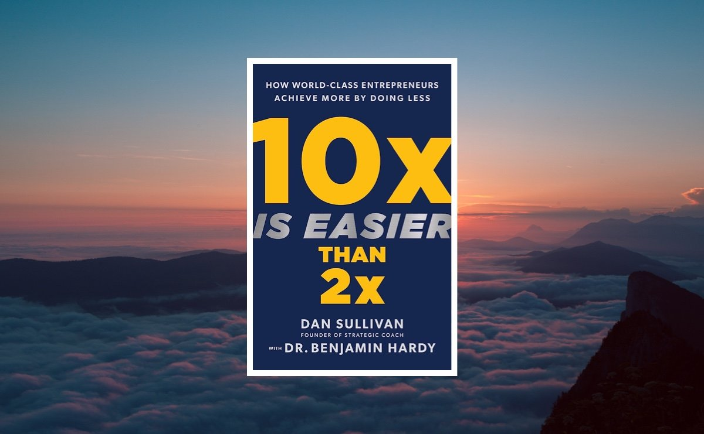

> This was the final book in the Zhou Zuoluo book club. Its Chinese edition had not yet been published, so Zhou arranged for someone to translate it—an early-bird version, you could say. Although the book contains plenty of theory and preaching, I still gained quite a lot from reading it through.

## I. Overall Impressions
This book is primarily about personal growth. Many people assume that tenfold growth is harder than doubling and requires ten times the effort. The authors tell us that 10x is about quality, not quantity.

First, set a 10x goal. Only when the goal is big enough will we stop spending time and energy on trivial things and put more into what matters most. After all, attention is more precious than time.

The authors also say that we need to schedule rest and recreation: better rest helps us achieve our 10x goals. I feel this deeply. I used to pack my days full, but execution was poor. Only the first third of my time went toward my goals; I wasted the remaining two-thirds endlessly scrolling on my phone. Now I am trying the Pomodoro Technique. I set each timer for twenty-five minutes, after which the app reminds me to rest for five. I can take that break without guilt and recharge for the next session.

## II. Selected Passages
### 1. Most people dare not commit fully to the 10x process because it inevitably requires giving up their current identity, environment, and comfort zone.
A 10x goal frightens most people. They choose 2x because a little extra effort may achieve it. But 2x is ordinary and 10x is extraordinary. Aim high and you may reach the middle. Set bold goals and give them your all.

### 2. Achieving 10x growth means simplifying your focus to its essential elements and removing everything unnecessary.
10x is more about quality than quantity.

### 3. Only by living within a 10x frame of reference will you become highly selective about everything you invest time and energy in.
A broader view lets you see more clearly and understand what you should be doing most.

### 4. You must elevate your identity and raise your standards, or your behavior will remain mediocre.
Do not fear competition. Improve yourself and pursue a higher level.

### 5. Those who take their unique ability seriously—and therefore take themselves seriously—make the greatest 10x leaps.
Play to your strengths, avoid your weaknesses, and use and amplify your unique ability. This is the best way to achieve 10x.

### 6. Finite games are played to win; infinite games are played to keep going.
Growth is an infinite game. We experience different kinds of growth at different stages.

### 7. To live wholeheartedly, we must consciously develop habits of sleep and play and stop treating busyness and exhaustion as status symbols.
Plan time for rest and play, and leave some time to think.

### 8. True psychological detachment means completely avoiding work-related activities and compulsive thoughts during nonworking hours.
### 9. Rather than trying to do several different activities every day of the week, focus each day on a particular type of activity.
Attention is precious. Put it on what matters most and avoid scattering it.

### 10. Urgent things are often unimportant, and important things are never urgent.

## III. Conclusion
For a 10x future, you must keep changing yourself. The things most worth doing each day are important but not urgent. Urgent but unimportant tasks can go on a to-do list and be handled together at a designated time.

May we all achieve our 10x goals!
