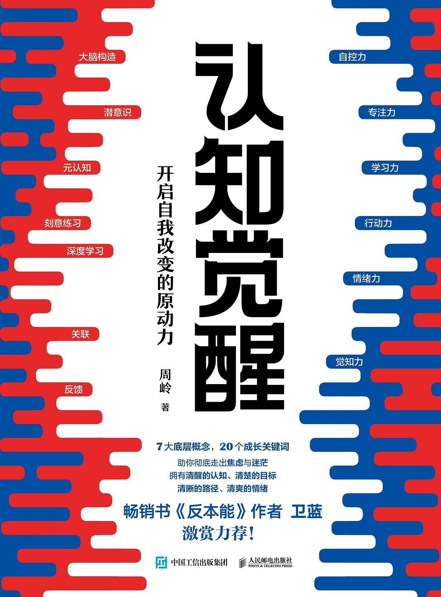

> I read this book on WeChat Read. I rarely use the app, but this book was free, and I had seen it recommended on many platforms, so I decided to try it. Although the title sounds like motivational fluff, some ideas moved me. Overall, reading it was worthwhile.

## I. Overall Impressions
This is a book about personal growth. I am thirty this year, exactly its target audience. As a programmer, I am approaching the “age-thirty-five crisis,” and I am already at risk of being laid off. I keep wondering what I can do after thirty-five. Build a side business? Work for a foreign company? Or continue hopping between small companies, accepting lower and lower salaries just to find work that barely pays the bills?

The book says that successful people turn other people's good habits into their own as soon as they discover them. I am also building habits: closing my Apple activity rings every day, studying English on Duolingo, and reading for twenty minutes daily. But these feel like checking boxes rather than deeply changing myself. Still, the author says that as long as you change, you may discover an entirely new self.

For nearly five years, I have been a devoted fan of paid knowledge products. Whenever I see knowledge for sale, I get as excited as middle-aged and elderly people hearing about traditional Chinese medicine and wellness. Twice I spent more than 4,000 yuan on professional training, and I have spent over 8,000 yuan on Knowledge Planet, Dedao, and Geek Time. I am a pretend learner: I have completed less than a tenth of those courses. It is like the online joke: you do not like knowledge or paying, but you do like paying for knowledge.

In this age of information overload, my lack of knowledge makes me anxious, yet I often only scratch the surface. Take the expensive .NET and big-data courses I bought. I completed less than a quarter of the .NET course, mainly using the accompanying interview questions for job interviews. The big-data course was an even worse waste: I attended the first few classes, hastily set up an environment, wrote a simple demo, and stopped. I was simply donating to the training industry. The author's view is that temporarily setting aside some knowledge is not frightening. As long as we keep learning, we lose nothing.

For my future, I plan to keep getting by in small-company jobs while starting a side business. Next month I will join Shengcai Youshu, gradually study cases, and participate in its “Voyage” programs. Of course, as the author says, things too far from us are usually beyond our grasp, whether painful or enjoyable. So I will begin with AI-assisted programming: it is closest to what I already do, and I have recently been using Cursor to help me code at work.

## II. Selected Passages
### 1. The best way to break out of existing habits is not through self-control but through knowledge. Relying on self-control alone is painful, while knowledge can easily give us new understanding and choices.
Self-control alone is hard to sustain. It is better to turn something into an easy, enjoyable habit—provided you choose something you love.

### 2. Incorrect positioning makes people feel it is too late for everything. In fact, the benchmark itself is wrong.
Be patient with yourself and believe you will gradually improve.

### 3. The core difficulty of anything that truly strengthens you is unavoidable. If you will not commit to tackling it and keep circling around it, you will only grow more anxious over time.
Some hard problems must be tackled personally. You cannot evade what is central and important.

### 4. Feeling anxious because you cannot improve immediately is itself a sign of impatience. Cultivating patience begins with accepting that you lack it. You cannot rush patience: allow yourself to change slowly and even to fail often.
Going slowly can actually be faster. With things that compound, be patient. Growth is slow at first, but if we persist, we will gradually reach the tipping point.

### 5. Most people will do anything to avoid real thinking.
I often come across this line. Every time, it makes me think seriously about what I should actually be doing.

### 6. Without sufficiently clear instructions or goals, we easily choose pleasure and abandon mentally demanding options we ought to stick with.
Set clear goals and milestones. A deadline makes a goal easier to stay committed to.

### 7. Once we face and accept hidden pressures, they become less troubling. This is why I encourage people to write down their confusion: once written down and clearly observed, tension, worry, and fear have nowhere to hide, and the weight of the little ball naturally lessens.
Writing things down lets the brain relax. When it carries too much, it cannot think. Regularly writing out your thoughts frees the brain's cache.

### 8. As soon as successful people discover someone else's good habit, they make it their own.
### 9. The worse your mood, the more you should exercise; the more you cannot figure something out, the more you should exercise.
Exercise helps thinking. This really is true.

### 10. Knowledge is only yours when it helps you make real decisions.
Put learning into practice. Knowledge gained on paper remains shallow.

## III. Conclusion
As long as you change, you may discover an entirely new self. Choose a goal and just do it!
