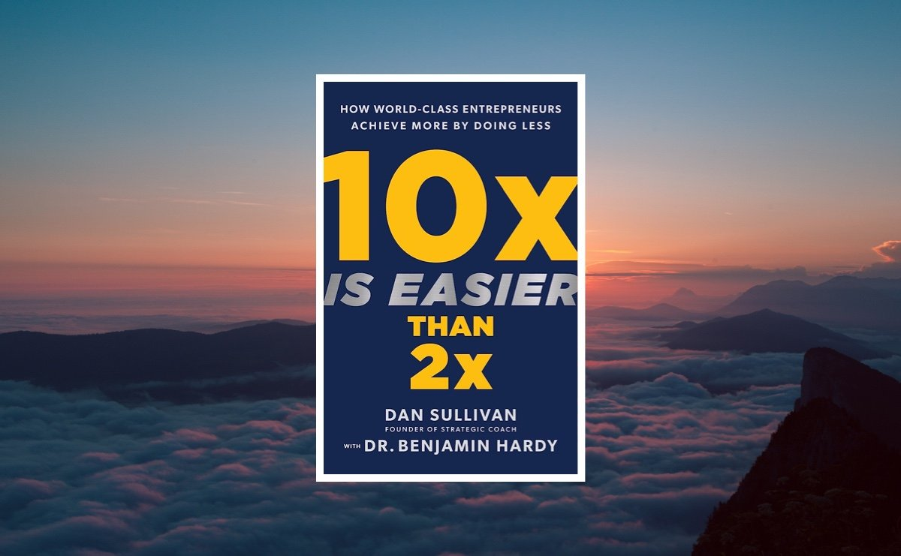

> 这本书是粥左罗读书会的最后一本书，这本书中文版尚未发布，是粥老师找人翻译的，算是早鸟版本了。整本书虽然理论和说教的内容较多，但是整本读下来也有不少收获。

## 一、总体感受
这本书更多的是关于自我成长的。很多人会觉得10倍比2倍更难，认为要付出10倍的努力才有可能达到10倍的成长，但作者告诉我们10倍是关于质量而不是数量。

首先，我们要定一个10倍的目标，只有目标足够大，我们才不会在一些琐碎小事上耗费时间和精力，而会把更多的精力投入到最重要的事情上去，毕竟注意力是比时间更宝贵的资源。

此外，作者还告诉我们，我们需要给自己安排休息和娱乐的时间，更好的休息才能更好的实现10倍的目标。我对此深有感触，我曾经将自己的一天安排得很满，但是执行效果却很差，导致自己只有前三分之一的时间在目标实现上，剩下的三分之二时间都在摆烂了（沉迷在无休止的刷手机中）。现在我尝试使用番茄工作法，一个番茄钟的时间设置为25分钟，时间一到，App就会提醒我该休息5分钟了，这个时候我就可以心安理得的休息5分钟，从而为下一个番茄钟养精蓄锐。

## 二、金句摘抄
- 1.大多数人都不敢全身心地投入到10 倍过程中，因为这不可避免地需要放弃你当前的身份、环境和舒适区。
10倍的目标会吓倒大多数人，大多数人会选择2倍的目标，因为2倍只要稍加努力就可能做到，但2倍是平庸，10倍是非凡。求其上，得其中，目标不妨大胆去定并全力以赴。

- 2.实现10 倍的增长是将你的关注点简化到核心要素，然后去除其他不必要的部分。
10倍更多是关于质量，而非数量。

- 3.只有生活在10 倍的参照系中，你才会对你投入时间和精力的每件事变得高度挑剔。
更大的视野能让自己看得更加清楚，才能明白自己最应该做的事情是什么。

- 4.你必须提升自己的身份，从而将标准提高到一个更高的水平，否则你的行为就会一直平庸下去。
不要害怕竞争，提升自己，去追逐更高的水平。

- 5.那些认真对待自己独特能力的人，也就是认真对待自己的人，是实现最大10倍飞跃的人。
扬长避短，发挥自己的独特能力，放大自己的独特能力，这是实现10倍的最好的方式。

- 6.有限的游戏是为了获胜而玩，而无限的游戏是为了持续进行。
成长是一个无限游戏，我们总会在不同阶段获得不同的成长。

- 7.如果我们想过一种全心全意的生活，我们就必须有意识地培养睡眠和玩耍的习惯，放弃将忙碌和疲惫作为身份的象征。
规划自己的休息和玩耍的时间，留点思考的时间。

- 8.当你在非工作时间完全避免与工作相关的活动以及强迫性想法时，才是真正的心理超脱。
- 9.与其在一周中每天尝试做几种不同的活动，不如在一天中只专注于特定类型的活动。
注意力是宝贵的，要把注意力放在最重要的事情上，避免分散注意力。

- 10.紧急的事情往往不重要，重要的事情从来不紧急。
## 三、总结
为了一个10 倍的未来，你必须不断地改变自己。每天最该做的是那些重要而不紧急的事情，紧急而不重要的事情可以放在待办列表上，找一些时间集中处理。

愿我们都能实现10倍的目标！
