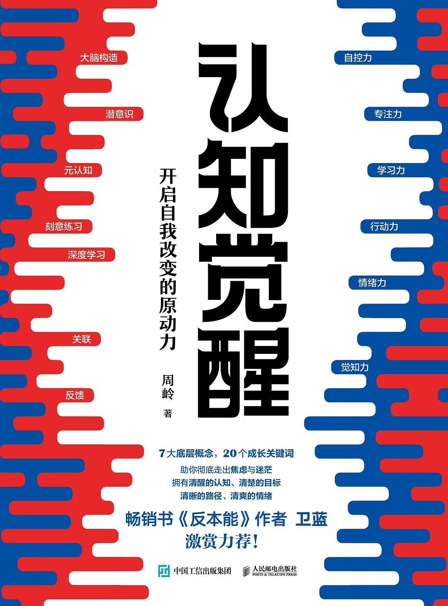

> 这本书是在微信读书上读的，我很少用微信读书，但是这本书免费，而且我在很多平台上都看到过这本书的推荐，所以还是决定读一读的。虽然这本书名看起来是鸡汤，但是书中还是有些观点触动了我，总之是开卷有益的。

## 一、总体感受
这是一本关于自我成长的书籍，我今年30岁了，正是这本书的目标受众。我是一名程序员，即将面临35岁危机，而且眼下也有被裁的风险。我一直在想自己35岁以后可以做什么，发展副业赚钱？去外企工作？还是像现在这样从一家小公司跳到另一家小公司，不断降低自己的薪资，只为换来勉强糊口的工作？

书中说，成功人士一旦发现别人的好习惯，就会立刻将这个习惯变成自己的。我也在给自己不断建立一些好习惯，比如每天的苹果运动闭环，比如每天的多邻国英语学习和每天20分钟的阅读。。。但我的这些习惯都像是打卡，没有深入去改变自己。但作者也说，只要去改变，就有可能收获全新的自己。

近五年来，我是知识付费的铁杆粉丝。我一看见要付费的知识，就跟中老年人听到中医养生一样兴奋。我曾两次花了超过4000块去报班学习专业技术，也曾花费8000以上在知识星球、得到和极客时间上。。。我是一个伪学习者，上面那些课程，我学了连十分之一都不到。这有点像网上那个段子，你不喜欢知识，也不喜欢付费，但却喜欢知识付费。

在这个信息爆炸的时代，我对自己知识的匮乏很慌张，但很多时候只是浅尝辄止。比如之前花大价钱报班学的.Net课程和大数据课程，.Net课程我连四分之一都没学，只是看了一些课程附赠的面试题用于面试；而大数据更是大怨种，只听了前几次课，草草搭了个环境，写了一个简单的demo就没再学了，完全是给培训行业做贡献了。作者对此的观点是：暂时放弃一些知识并不可怕，只要持续学习，我们不会损失什么。

关于自己的未来，我的想法是暂时主业还是在小公司之间苟且着，同时开始发展自己的副业。下个月会报名生财有术，会慢慢开始学习一些案例，参加航海行动。当然，作者也说了，距离我们太远的事情，我们通常无法把握，无论它们是令人痛苦的还是享受的。所以，我还是会从AI编程开始学习，毕竟这个离我最近，而且我最近也在工作中用Cursor来辅助我编程了。

## 二、金句摘抄
- 1.要想从既有的习惯中跳出来，最好的方法不是依靠自制力，而是依靠知识。单纯地依靠自制力是非常痛苦的事，但知识可以让我们轻松产生新的认知和选择。
单纯靠自制力是很难坚持下去的，最好将其变成一种习惯，一种轻松愉快的习惯，当然前提是你得选择你热爱的。

- 2.错误的定位只会让人觉得一切都来不及了，事实上，这根本就是错误的对标。
要对自己有耐心，要相信自己会慢慢变好的。

- 3.真正能让你变强的东西，其核心困难是无法回避的，不下决心与之死磕，始终在周围打转，时间越长越焦虑。
有些硬骨头需要自己去啃下来，核心重要的东西不能逃避。

- 4.如果对自己不能立即变好这件事感到焦虑，这本身就是缺乏耐心的表现。培养耐心要从接受自己缺乏耐心这一事实开始。耐心就是这样，不能急于求成，允许自己缓慢地改变，甚至经常失败。
慢慢来，反而快。在做有复利效应的事情时，要有耐心，前期是增长缓慢的，但我们只要坚持做，会慢慢达到引爆点的。

- 5.多数人为了逃避真正的思考，愿意做任何事情。
这句话经常能刷到，每次看到都会让我深入思考下自己究竟该做什么。

- 6.当我们没有足够清晰的指令或目标时，就很容易选择享乐，放弃那些本该坚持但比较烧脑的选项。
所以要给自己定下清晰的目标，定下一些里程碑，有了deadline，目标才更能坚持下去。

- 7.一旦正视、接纳之后，那些隐性的压力也就不那么让你伤神了，这也是我一直倡导大家把心中的困惑写出来的原因，因为只要写出来，那些紧张、担忧、畏惧、害怕等情绪就会在清晰的观察下无处遁形，小球的重量自然会减轻。
写下来是为了让大脑放松，大脑承载东西太多后，便没办法思考了。定期把自己的想法写下来，便能释放大脑的缓存。

- 8.成功人士一旦发现别人的好习惯，就会立刻将这个习惯变成自己的。
- 9.越是心情不好的时候就越要多运动，越是想不通的时候就越要多运动。
运动有助于思考，这是真的。

- 10.只有当知识能够帮助你做实际决策的时候，它才是你的知识。
学以致用，纸上得来终觉浅。

## 三、总结
只要去改变，就有可能收获全新的自己。找准一个目标，just do it！
